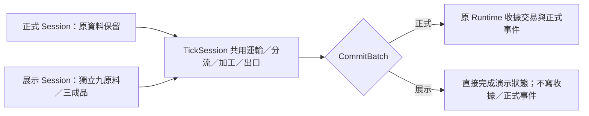

# SDG Adventure V11 Phase 2 — 工程交付與待驗收項目


**最新原生回報基準：**使用者在 Unity 2023.1.22f1 對 `ebe9aab6c2756bd3bd59b9f4c5befe05c84fcbdb` 確認 Phase 2 18／18、V9 5／5、V11 7／7、Recycling Art 6／6及排氣管兩項 PASS，共38項；另有三項明確 FAIL，其他10項逐項結果未提供。這些結果只屬於該 SHA。文末 **V11 Phase 2.1／2.2 — Unity Native Failure Repair** 記錄 R1／R2／R3 修正與完整51項結果表；新修正的 Unity 編譯、PlayMode、人工遊戲皆 NOT RUN。以下各舊章節保留當次交付歷史，不能當作目前驗收狀態。
本報告區分**已實作**及**已驗收**。沒有 Unity Editor 的來源檢查不能代表編譯、PlayMode 或遊戲通過。

**歷史原生回報（5cd7328）：**使用者實測 CargoFollowsRoute PASS、Phase 2 **17 PASS／1 FAIL**、V9五項及V11七項PASS。OutputConveyor 在 BoxCast 零間隙校準即失敗（約 -2.496mm），尚未進入正式九成品輸送驗證。本次量測修正與所有新提交 NOT RUN 狀態見文末 **OutputConveyor Native Contact Calibration Repair**；以下歷史 PASS 不沿用到新提交。

**後續實測更新：**使用者在 `aee6dc70b0a2b2792e8e18edffc9b0d57127ee49` 回報 Phase 2 **16 PASS／2 FAIL**、V9 **5 PASS**、V11 **7 PASS**。兩項失敗已確認，修正分析及新提交的 NOT RUN 狀態見文末 **Phase 2 Unity PlayMode — Cargo Collision and Output Contact Repair**。以下 A–G 保留初次交付紀錄，不能沿用為新提交 PASS。

- Phase 1 基準：`ed26bfc9e281737e96421be149f7b539eb79326c`。
- Head：`feature/v11-phase2-recycling-line`；Base：`feature/v11-factory-rebuild`，依賴尚未合併的 [Draft PR #2](https://github.com/LinSean-ww/SDG-Adventure-Recycle/pull/2)。不修改 #2、不合併 main、不強制推送。
- 專案 Unity 版本 `2023.1.22f1`；本環境沒有可用 Unity Editor／授權。
- 使用者先前回報 V9五項、V11七項、雙樓梯、晶片只取得一次、PVC PASS，僅是 Phase 1 基準，新提交不可沿用 PASS。
- 《高科技回收分類工廠全景.png》及指定 V11 試玩截圖**尚未直接取得**；未逐圖比對，未以生成圖片冒充實際畫面。

| 階段 | 程式實作 | Unity 驗收 |
| --- | --- | --- |
| 2.1 高位入口、局部牆洞、連續設備 | 已實作 | NOT RUN |
| 2.2 統一流程、型別映射、去重 | 已實作 | NOT RUN |
| 2.3 三類加工、3→1、出口收集 | 已實作 | NOT RUN |
| 2.4 支柱、管線、回歸與報告 | 已實作支柱／管線，新增18項測試並遷移過時斷言 | NOT RUN；實際回歸驗收未完成 |

## A. 原架構問題與整合

原 ReferenceFactory 的 packages／bFeedPackets 各自循環，BuildOutfeedPallets 初始化成品與投入無關。Presentation 另建 C3_SortingSimulation 推進動畫及 CompletedCycles；Workshop 根據週期推測材料增加統計；EcoConveyorSorter Trigger 又能獨立加計數及銷毀。三套路徑無法證明同一份原料真的運輸、加工、輸出。

現在 `C3RecyclingLine` 統一管理唯一 ID、類型快照、CurrentRouteSegment、TargetMachine、State History、Counted／ProcessingComplete／ProductCreated、BatchId 與成品。`C3RecyclingLineGeometry` 生成設備並呈現指定的壓頭／推桿狀態；`C3ConveyorSection` 綁定真實 START／END、Renderer 及帶面 Collider。

Presentation 保留啟動燈光／音效／Device 訂閱；CompletedCycles 改讀正式批次數。ReferenceFactory 保留倉體、地坪、PVC、原工作站及公用管線，停止生成兩組循環原料、舊設備及預置成品。Workshop 保留取料／檢測／武器，移除依假週期增加統計。八件舊設備 OBJ 資產與 GUID 保留，但不再實例化；舊 SortingSimulation 整個停用並銷毀。

Phase 1 的157個舊結構 leaf、53個舊裝飾碰撞路徑仍用精確 allowlist 清理；不擴大停用任意 Collider，原上層工作桌／配電箱、互動及 Trigger 保留。

## B. 完整物料路線與設備

下列均為**來源設計值，非 Unity 世界 Bounds 量測**，單位 m。設備由原 Presentation 的 Awake 建立；進入 Play 後於 `C3_P2_RecyclingLine` 檢查，不是編輯模式預置的另一套設備。

高位入口 `(1.2,7,12.5)` → `(-.9,7,12.5)` → `(-3.8,7,12.5)` → `(-3.8,7,16.85)` → `(-4.8,7,16.85)` → `(-6.2,5.8,16.85)` → 主帶終點 `(-19.5,5.8,16.85)`。前五段寬1.10、主帶寬1.52，方向依箭頭。轉彎後先水平離開上一帶寬，再下降約40.6°，避免直接穿入舊帶面。主帶來源 Y=5.62→5.80。

原 `C_Wall_4_Lintel` Collider 世界 Y=3.5..10，原 Transform 不動，只改局部 center Y=-1.75、size Y=3，留下 Y=3.5..6.5。新增三個同姿態可見 Cube／BoxCollider 代理：

| 代理 | 中心 | 完整尺寸 |
| --- | --- | --- |
| P2_WALL_HIGH_NEAR | (-.3,7.3,10.825) | (.15,1.6,1.65) |
| P2_WALL_HIGH_FAR | (-.3,7.3,14.175) | (.15,1.6,1.65) |
| P2_WALL_HIGH_HEADER | (-.3,9.05,12.5) | (.15,1.9,5) |

物料淨開口 Y=6.5..8.1、Z=11.65..13.35，附安全邊框；保留人員過樑下緣 Y=3.5、地面門洞、PVC、B_Door_Floor 及 B_Safety。Scene 只改該 Collider／父 child list，增加15個 YAML文件、三個可見實體代理。

| 類型 | 機體中心 | 主帶分流點 | 上部料斗接口 | 加工床中心 | 正式出口 | 收集中心 |
| --- | --- | --- | --- | --- | --- | --- |
| Paper | (-17.9,.55,14.8) | (-16.7,5.8,16.85) | (-16.7,4.45,15.6) | (-17.9,2.4,15.2) | (-17.9,1.25,12.75) | (-17.9,1.25,9.1) |
| Metal | (-13,.55,14.8) | (-11.8,5.8,16.85) | (-11.8,4.45,15.6) | (-13,2.4,15.2) | (-13,1.25,12.75) | (-13,1.25,9.1) |
| Plastic | (-8.1,.55,14.8) | (-6.9,5.8,16.85) | (-6.9,4.45,15.6) | (-8.1,2.4,15.2) | (-8.1,1.25,12.75) | (-8.1,1.25,9.1) |

令機體中心 X=x，每台實際接續為：

1. `(x+1.2,5.8,16.85)` 水平出主帶至 `(x+1.2,5.8,15.8)`，寬1.25。
2. 上方重力溜槽至 `(x+1.2,4.45,15.6)`，寬1.25；機內陡槽至 `(x+1.2,2.4,15.3)`，寬.90，約81°，沿相同水平向下降，從壓頭側面進料。
3. 寬.90的水平接料床至 `(x+1.2,2.4,15.0)`；再沿真實 PROCESS_BED 分到 `(x-.32,2.4,15.0)`、`(x,2.4,15.0)`、`(x+.32,2.4,15.0)`。床寬3.20、深1.00、頂Y2.40。
4. 成品在 `(x,2.4,15.2)` 形成，水平出料床至 `(x,2.4,14.7)`，機內斜帶至 `(x,1.25,12.75)` 正式出口，寬1.55。
5. 獨立下帶至 `(x,1.25,9.8)`，寬1.55；寬2.40收集床至 `(x-.65,1.25,9.1)`、`(x,1.25,9.1)`、`(x+.65,1.25,9.1)`，依批次逐格放置。

主帶前護邊在三個分流點各留1.40m實體缺口；壓床內短接／出料床不放橫切原料的側板。機殼中空，保留入口／出口；外露長段具有護邊、滾輪、鋼架。有限帶面長度與端點一致，不讓上一平帶延伸成陡槽上方的懸挑台階。

姿態在接點.35m內平滑轉向，段內跟隨帶面法線。SphereCast／BoxCast 用相鄰真實帶面 Collider 決定接觸高度，世界位移限制原料4.5m/s、成品2m/s，避免陡槽邊緣跳位。這些原生查詢尚待 Editor 實測。

完整表見 [V11_Phase2_Topology.csv](V11_Phase2_Topology.csv)：30個設備段、9條原料床位、9條成品收集路線。basis 明標 SOURCE_DESIGN_NOT_UNITY_MEASUREMENT；方向 Start→End，Y 是表面而非物料中心。

## C. 型別、加工、計數與生命週期

Enum 保留 Metal=0、Plastic=1、Electronics=2，附加 Paper=3。機台映射 Paper0／Metal1／Plastic2，舊 Runtime 接口 Plastic0／Metal1／Paper2。Electronics 拒絕進三分類線，電子快取／量子武器仍獨立。來源搜尋未發現場景／Prefab 序列化引用 EcoRecycleCargo script GUID；仍保留原 enum 值及 meta 供外部內容相容。

每個可視原料球為1投入單位，三個同類單位實際到床後才加工2.5秒。維持同一 GO 運至加工床，壓頭按 Processing 進度下壓／回升，原料同步變形；完成才準備紙捆／金屬壓塊／塑膠捆。成品保留唯一 BatchId 與三個 SourceMaterialIds。3→1是投料批次規則，不聲稱模型體積等於質量／密度；本體.52×.42×.50，含束帶運輸包絡.52×.43×.51。

Runtime 原子驗證批次、原料ID、唯一性、型別及容量後才計數、顯示成品並發出一次 BatchCompleted。交易拒絕時保留單一隱藏待提交成品及 LastBlockedReason，不重生或重複加數；生成成品前先檢查實際輸出帶面，避免缺失帶面時每次重試留下新的隱藏物件。分類只解鎖原取料點，不自動 AddItem，不改彈藥／快捷欄。

`Spawned → Feeding → MainBelt → Identified → Diverting → MachineInput → Processing → OutputReady → Outfeeding → Collected`

- AcceptedUnits = WaitingUnits + ProcessingUnits + ProcessedUnits。
- ProcessedUnits = 3 × ProcessedBatches。
- CollectedProducts ≤ OutputProducts ≤ ProcessedBatches。
- WaitingUnits 含未釋放及運輸／床位等待；FedUnits 為已上帶單位。
- OutputProducts 只在越過 MACHINE_OUTPUT 後增加；CollectedProducts 只在到達收集格後增加。

每機最多9單位／3捆，總27原料／9成品；三床位預留、主線至少1m參數間距、有背壓。內建 useFiniteTestSupply 只供九件，每類三件，使用場景 GUID 的新 ID；**這是 C 側有限演示，不是正式 B 區供料或通關**。

正式接入接口為 `P2_B_HIGH_INFEED_INTERFACE` Transform＋TryAcceptCargo：同一場景、唯一ID、支援類型、materialUnits=1、入口+Y.12附近.15m內、世界scale=1、小型可見模型、無啟用的非Trigger Collider或動態Rigidbody。接管同一GO；拒絕不修改／銷毀上游。C_Main 的 EcoConveyorSorter 只委派接口，無管理器的其他場景保留明確映射的舊相容路徑。未建立虛構 B 生成器；新增測試臨時建立原生 Trigger／kinematic Rigidbody 驗證交接。

Dormant／Starting 不輸送、不加工、不正式加數；Running 正常處理；Completed 只排空既有物料、拒收新料，不改原任務出口。Time.timeScale=0不前進，停用再啟用不重播供料／重建設備。新增設備／物料場景擁有，材質共用並在 OnDestroy 釋放，Update 不建 Material。

同一持久 Runtime receipt ledger 跨場景重載保留已完成ID；C_Main仍依原規則重置本關解鎖計數，背包／彈藥／快捷欄保留。ledger上限4095單位，滿時拒收、不淘汰去重；未完成物料可由上游重試。沒有新增跨程式重啟存檔承諾。

## D. 二樓走道、支柱與管線

下表 Bounds 是來源推算，原生 Bounds／角色／鏡頭均未驗收。

| 結構 | Phase 1 | Phase 2 | 理由 |
| --- | --- | --- | --- |
| 六根 V11_EDGE_SUPPORTS | X=-24.10／-.65；Z14.5／17.5／20.9；截面.14 | X=-24.32／-.43；Z13.75／17.95／21.20；截面.18 | 平台外側接點，新增平台底懸臂梁／斜撐 |
| 十三根倉體裝飾柱 | 西X=-24.53、東-.45；截面.30×.32 | 西-24.70、東-.12；截面.18×.22 | 嵌牆避開長廊，仍無實體Collider |
| 十三踢腳板 | 舊柱位，.36×.48×.39 | 新柱位，.22×.48×.26 | 避免模型伸入走道 |
| 七根屋頂橫樑 | X中心-12.5、長24 | 中心-12.41、長24.58 | 接移動後柱位及吊架 |
| 五條供應管 | 基準Y7.60；外側X=-23.7／-1.38 | 基準Y8.80；外側X=-24.55／-.15 | 最低垂直吊夾端點Y6.89→8.09，避頭部／高位橋 |

支柱Y=.56..4.32，梁撐不穿頂Y4.50平台。來源推算西柱X Bounds=-24.41..-24.23、東=-.52..-.34；裝飾柱向走道內緣=-24.61／-.21。

中央管舊端點 `(-6,4.28,15.94)→(-5.7,5.6,16.52)→(-3.9,5.98,17.1)`，改 `(-5.8,4.28,15.94)→(-5.8,8.65,15.94)→(-3.9,9.2,17.1)` 避轉接帶。高位橋三組屋頂吊架，主帶四組 X=-8.5／-10.5／-15.4／-19.3、Z=16.85±.88、底Y5.8頂11.45，避開分流口並連到Z16屋樑；B側加懸臂連到C屋樑，PVC／東梯下無新增落地柱。

逐件68筆新舊中心／尺寸與新增支撐見 [V11_Phase2_SupportChanges.csv](V11_Phase2_SupportChanges.csv)。NEW舊值空白；旋轉圓管尺寸不是世界AABB。

原 CharacterController 半徑.30、站高1.80、skin .08、步高.30、坡限45、趴高.75、雙22階樓梯、14段實體護欄、工作桌／晶片位置與ID保留。上層站姿頭頂約Y6.30。測試使用原 TickMovement→CharacterController.Move 走雙梯、長廊、後平台、趴姿及防墜，另查原生 CapsuleCast 頭部淨空；不縮小角色、不放寬原.01m斷言。

## E. 測試與實際結果

```text
Unity Compilation: NOT RUN
Unity PlayMode: NOT RUN
Manual Gameplay: NOT RUN
```

### 已執行的來源檢查

| 檢查 | 結果及界線 |
| --- | --- |
| git diff --check | PASS；僅空白格式 |
| Tree-sitter AST | PASS；110檔、910方法、122個IEnumerator的yield／return來源檢查；不是型別／語意編譯 |
| Scene YAML／新局部引用 | PASS；2168→2183 ID，僅牆Collider／父child list改動；不是Unity匯入 |
| 相容／保護比對 | PASS；原meta、Prefab、asmdef、Packages、ProjectSettings、玩家／零件／裝置／解謎、背包武器原方法、樓梯平台護欄builder保留 |
| 舊碰撞清單 | PASS；157結構leaf、53舊裝飾路徑可解析，未誤納上層工作站 |
| 新meta | PASS；7個新資產成對且GUID唯一 |
| 測試／反射來源 | PASS；保留5／7名稱，新增18項，檢查成員／方法／參數型別；無Ignore／Explicit／不相容NonParallelizable；不是Unity反射執行結果 |
| 原料數值路線審查 | PASS，僅限新帶面／護邊／機殼／吊架／開口代理的來源模型：489取樣無預測>1.1mm穿入，.05s位移約≤.225m；不涵蓋完整Unity世界、成品原生接觸、角色或實際Bounds |

### Phase 2 PlayMode（逐項）

| 測試 | 驗證設計 | 結果 |
| --- | --- | --- |
| ElevatedInfeed | 實際高位接口／帶面尺寸與材質 | NOT RUN |
| WallOpeningClearance | 原生SphereCast上洞、牆體／PVC保留、地面雙向行走 | NOT RUN |
| ContinuousConveyorRoute | 30段Renderer／Collider、端點Raycast與原生接點接觸 | NOT RUN |
| IngressIdentityAndTriggerDedup | 原生Trigger交接同一GO，重複不計數 | NOT RUN |
| CargoFollowsRoute | 同一ID／GO、歷史、真實接觸、沿途穿入與壓頭避讓 | NOT RUN |
| PaperSorting | 紙類實到正確機床、成品及舊統計映射 | NOT RUN |
| MetalSorting | 金屬實到正確機床、成品及舊統計映射 | NOT RUN |
| PlasticSorting | 塑膠實到正確機床、成品及舊統計映射 | NOT RUN |
| ProcessingState | 不足三份不加工／不提前加數，三份到床才開始 | NOT RUN |
| MachineOutput | 可見壓頭位移、加工前無成品、成品在機內形成 | NOT RUN |
| OutputConveyor | 同一成品移動、實際包絡接觸／ComputePenetration、三出口到收集 | NOT RUN |
| MaterialAccounting | 9→3、逐tick守恆、重播／Trigger去重、事件次數、背包彈藥不自增 | NOT RUN |
| ActivationState | Dormant／Starting、暫停、Completed排空拒收 | NOT RUN |
| ReloadSafety | 真重載、單設備根、重啟與收據不重播 | NOT RUN |
| UpperWalkwayClearance | 原角色站姿／頭部、東上西下 | NOT RUN |
| ChipAndGuardRegression | 西上取一晶片東下、站趴防墜、PVC雙向 | NOT RUN |
| ProneWalkwayClearance | 原角色趴姿走東／後／西長廊 | NOT RUN |
| Regression | 零件、解謎、取料、工作台、武器及跨場景背包彈藥 | NOT RUN |

### V9／V11 及輔助回歸

| Suite／測試 | 本分支結果 |
| --- | --- |
| V9 ReplacementStairsHaveMatchingPhysicalTreadsOnBothSides | NOT RUN |
| V9 BReceivingBeltActuallyExistsOnCFrontFaceAndMeetsMainHighBelt | NOT RUN |
| V9 ReplacementDeckWorldBoundsMatchBothStairExitsAndRearBay | NOT RUN |
| V9 PlayerCanClimbRightStairAndReachRearMaintenanceBridge | NOT RUN |
| V9 PriorFloorStripeIsPassable | NOT RUN |
| V11 WalkACollectExactlyOneChipAndReturnDownB | NOT RUN |
| V11 WalkBThenRearConnectionAndDescendA | NOT RUN |
| V11 GroundBCDoorApproachRemainsOpenUnderTheEastFlight | NOT RUN |
| V11 EveryGuardStopsStandingAndProneCapsulesIncludingCorners | NOT RUN |
| V11 WorldGeometryMatchesEnabledCollidersAndHasNoHeadObstructions | NOT RUN |
| V11 LegacyCleanupPreservesFloorTriggersAndSurvivesSceneReload | NOT RUN |
| V11 OriginalPartsConsoleSortingBenchesAndWeaponStillOperate | NOT RUN |
| M6FlowTests.FactoryStartupAndThreeWasteTypesUseBoundedVisualPool | NOT RUN |
| C3VisualFPSIntegrationTests.ReferenceFactoryBuildsThreeSortersWithoutChangingPuzzle | NOT RUN |
| Unity Compilation | NOT RUN |
| Unity PlayMode | NOT RUN |
| Manual Gameplay／Profiler | NOT RUN |

V9低位OBJ名稱／尺寸與V11最後的舊feed Bounds斷言，替換為30段真實設備Renderer／Collider、Raycast、Overlap接點驗證；其餘四個V9、六個V11測試本體保留。有限帶面端點Raycast向內取樣1mm避浮點盒邊，仍比對原端點並保持.01m容差，接點另查原生重疊。M6舊waste/feedMarks/sortedMarkers反射改查正式物料／批次；VisualFPS預置18件假原料與V8設備斷言改查實際線、工作站／PVC／機體碰撞。共用原V11持久Runtime暫停／替身／還原流程，保護原背包、輸入、Time、Cursor、視角偏好與事件訂閱。

`C3V7CZoneBoundaryAndAisleTests` 仍要求封閉 V7_OPAQUE_C_TO_B_RECEIVING_SHUTTER、V8_B_To_C_ContinuousRubber及舊V8_MAIN_STAIR_CONTINUOUS_RAMP。這是已知歷史規格衝突，未修改、未Ignore、未執行；不是已證實的新Phase 2 FAIL，也不能宣稱Run All PASS。其餘專案測試亦NOT RUN。

## F. 修改檔案與 GitHub

相對Phase 1共26檔（含7新meta），以下均在 `Assets/_Modules_/`：

- `02_Levels/Level03/Scenes/C_Main.unity`：局部高位牆洞代理。
- `02_Levels/Level03/Scripts/C3ConveyorSection.cs`、`C3RecyclingLineGeometry.cs`、`C3RecyclingLine.cs`，各含新meta。
- 同Scripts：`C3FactoryPresentation.cs`、`C3ReferenceFactoryEnvironment.cs`、`C3V3Circulation.cs`、`EcoRecycleCargo.cs`、`EcoConveyorSorter.cs`、`EcoAdventureRuntime.cs`、`EcoFactoryWorkshop.cs`。
- `05_Testing/PlayMode/C3V11Phase2RecyclingLineTests.cs`與新meta；`C3V9VisibleIndustrialRouteTests.cs`、`C3V11SafeCirculationTests.cs`、`M6FlowTests.cs`、`C3VisualFPSIntegrationTests.cs`。
- `07_Docs/DevelopmentReports/V11_Phase2_Report.md`、`V11_Phase2_Topology.csv`、`V11_Phase2_SupportChanges.csv`，各含新meta。

不納入.vscode、Library、Temp、Obj或本機檢查產物；Phase 1報告不改。里程碑提交：

- `fd0c6c061acbe3919561483ad0e48b2dc387619c` — feat(v11-p2): rebuild elevated B-side material infeed
- `f9890ab222c5e6a37d8e687ba9b14b10a2c0f097` — feat(v11-p2): unify recycling cargo flow and sorting
- `7b6f95e9574a1d781732b5c1152d2497f67c591f` — feat(v11-p2): implement processing and three output conveyors
- `30b17cb3bf64cedd0a3708b8444b3b7be61c56d9` — fix(v11-p2): align mezzanine supports and clear walking routes
- `f5b9d43510117ba806184713dcc3770e5c0503a9` — fix(v11-p2): clear material handoffs and finite belt contacts


另以 `test(v11-p2): add recycling line integration coverage` 提交最終測試／報告；完整最新SHA、新Draft PR URL見交付訊息及PR commits（報告無法內嵌其自身提交SHA）。新PR Base必須是Phase 1分支，標明依賴#2，維持Draft等待ChatGPT審查與使用者驗收。

## G. 未解決項目與使用者驗收

`B→C Full Level Transition: BLOCKED — Level02 scene unavailable`

完整Level02/B_Main.unity缺少，只完成C側接口、有限演示及人員通道保護；沒有虛構B通關條件／任務進度／玩家傳送。

其餘待驗收：Unity編譯與反射實際執行、30段世界Bounds／接點、陡槽與成品有限帶面接觸、站趴／相機淨空、材質／機械外觀、指定圖片接近程度、FPS／背包／武器及效能。來源推算不能排除Unity匯入、原生物理或鏡頭下的問題。四階段程式與測試已實作，實際遊戲驗收尚未完成。

1. 關閉Unity，GitHub Desktop Fetch／Pull，切換 **feature/v11-phase2-recycling-line**，確認最新交付SHA。本機.vscode不需提交此PR。
2. Unity 2023.1.22f1等待編譯／匯入，先檢查Console紅字；保留完整訊息，不以按Exit Safe Mode當作修復成功。
3. Test Runner→PlayMode：Phase 2的18項、V9的5項、V11的7項，再跑上表兩項輔助回歸，匯出XML；歷史V7衝突另記。
4. C_Main進Play，Dormant無正式物料／成品；實收原三零件、完成控制台解謎並啟動。
5. 跟隨高位九件演示料，每類三件，同一路線／正確分流，三份到床才壓縮；各成一件紙捆／金屬塊／塑膠捆，由各自機內出口到收集床，久候不再無限生。查看Materials／Products／收據，分類不直接加背包材料。
6. 暫停／恢復；完成任務只排空既有料。重載確認一套設備、背包彈藥快捷欄保留、舊已完成ID不重播；新場景九個新演示ID屬新批投入。
7. 實走西上東下、東上西下、後平台、維修工作桌及轉角；Z趴走長廊、測護欄防墜、晶片只加一個、PVC可見雙向通行。再驗WASD、視角、左射／右瞄、Q/E、R、TAB、1～5、原取料／工作台／武器。
8. 提供Console、XML、必要Game／Scene View與異常位置供審查修正。驗收前維持Draft，不合併。

## Phase 2 Unity PlayMode — Cargo Collision and Output Contact Repair

### A. 原始測試結果：CONFIRMED PLAYMODE TEST FAILURES

使用者提供 Windows Unity **2023.1.22f1** 實測，失敗基準 SHA `aee6dc70b0a2b2792e8e18edffc9b0d57127ee49`：Phase 2 **16 PASS、2 FAIL**；V9 **5 PASS**；V11 **7 PASS**。這是該基準的使用者測試結果，不是本雲端執行結果，亦不能沿用為本次修正後 PASS。

```text
CargoFollowsRoute (1.518s)
Cargo penetrates IDENTIFIER_UPRIGHT
Expected: greater than or equal to 0.119000003f
But was: 0.0f
C3V11Phase2RecyclingLineTests.cs:224

OutputConveyor (2.577s)
Finished product floats above its actual finite output surface
Expected: True
But was: False
C3V11Phase2RecyclingLineTests.cs:315
```

上述檔案行號為原失敗版本。原始紀錄未附物料中心／Batch ID／輸出段，因此不能聲稱已在雲端重現原生碰撞位置或已測得成品懸空距離。

### B. CargoFollowsRoute：幾何修正及穿透量測

來源確認：三台分流沿固定 X 向 -Z 移動，原前立柱卻在同一個 X、Z=15.93，Y Bounds=5.80..6.50、厚 .10m，位於原料半徑 .12m 的掃掠範圍內。ClosestPoint 回傳中心造成距離0，並不是穿透深度0。此幾何問題不能以忽略立柱處理。

將**整組辨識架**沿主帶上游（+X）移 .45m，橫樑／感測器一起移動，尺寸、實體立柱／橫樑 Collider、分流點、推桿及所有正式路線不變。新位置仍在主帶開始端內側，物料先經掃描架才到分流口。

| 機台 | 原前／後立柱 | 新前／後立柱 | 新橫樑 | 新感測器 |
| --- | --- | --- | --- | --- |
| Paper | (-16.70,6.15,15.93)／(-16.70,6.15,17.77) | (-16.25,6.15,15.93)／(-16.25,6.15,17.77) | (-16.25,6.55,16.85) | (-16.25,6.43,16.85) |
| Metal | (-11.80,6.15,15.93)／(-11.80,6.15,17.77) | (-11.35,6.15,15.93)／(-11.35,6.15,17.77) | (-11.35,6.55,16.85) | (-11.35,6.43,16.85) |
| Plastic | (-6.90,6.15,15.93)／(-6.90,6.15,17.77) | (-6.45,6.15,15.93)／(-6.45,6.15,17.77) | (-6.45,6.55,16.85) | (-6.45,6.43,16.85) |

以上是**來源座標，非新版本原生 Bounds 實測**。來源推算三條路線同樣具有：主帶物料到立柱側面至少 .75m 淨空、分流中心線到立柱表面 .40m（扣 .12m 原料半徑後 .28m）、立柱到推桿整個行程包絡的 X 淨空 .05m；分流上段護邊與立柱 X 分離至少 .125m。平帶原料頂約6.041，感測器底6.39、橫樑底6.49，分別約 .349／.449m 垂直間隙；其他共用主線與轉角亦納入來源取樣。

擴充來源數值模型，補入上一版漏掉的辨識架、感測器與推桿動作。同一489個路線取樣在舊位置預測9處立柱干涉（例如來源中心 `(-16.7,5.921,15.9501)`，估算球／盒最小分離深度約 .14994m），移動後預測超過1.1mm的干涉為0。這只是來源數值重播，不是原始 Unity 的實際中心／深度，也不涵蓋完整 Unity 場景。

測試保留 `CargoFollowsRoute` 名稱，改為紙／金屬／塑膠各一份，同時走正式共用主線及各自分流、轉彎、料斗到加工床。保留 ID／GO／類型不變、狀態歷史、目標機與單步 <.37m。合法支撐僅限真正 current／相鄰路段的帶面／加工床；距離仍 <.01m。OverlapSphere 只找候選，啟用的 .12m SphereCollider 探測器以 ComputePenetration 量實際深度／方向，帶面也不排除過深穿入；另以真實 box mesh 的局部尺寸和世界旋轉檢查無實體 Collider 的感測器、壓頭與推桿，不能藉停用其 Collider 掩蓋可見穿模。

新增已知球／盒重疊及分離正負控制，避免查詢一直回 false 卻假通過。失敗才組合 Material ID／類型／狀態／路段／中心／半徑、支撐端點與差距、物件路徑、實際穿透深度／方向及校準結果；正常影格不輸出 Log。

### C. OutputConveyor：分開支撐、間隙與穿透

原探測器為 `shape.enabled=false`，尺寸膨脹 `envelope.size + .006`（每側3mm），再把 ComputePenetration 為 true 當支撐的唯一證據。這不能可靠區分恰好接觸、合法1mm間隙與懸空。**未取得此環境下 disabled collider 的原生查詢結果，不斷言停用是唯一根因；原始 FAIL 也不足以證明真正懸空。**

正式 Evaluate 的約1mm上方間隙與所有出口設備幾何不改；只調整三個既有收集格的到達順序，處理新增多成品覆蓋查出的干涉（下述）。測試使用以下三層驗證：

1. **先校準 API：**隔離的單位 BoxCollider 在已知100mm重疊、100mm分離、表面接觸、1mm間隙各查詢啟用／停用模式並記錄結果；啟用模式必須通過正負控制，恰好接觸可回 false，不要求重疊。停用結果只供比較，不預設它一定有效或一定無效。後續穿透判斷一律用已校準、啟用的探測器。
2. **支撐／有限帶面：**由所有實際成品 mesh 頂點建立產品局部包絡，套用真實世界旋轉，不拿 world AABB 當精確距離。從成品上方20mm向下 BoxCast 40mm，僅接受 current／相鄰路段與機內相鄰加工床命中；以 hit.distance 減20mm取得有號垂直間隙，最大正間隙3mm。20／40mm是搜尋窗，不是允許懸空的容差。另以隔離實體帶面驗證0、1、10mm間隙：0／1mm應有支撐，10mm應判為懸空。
3. **實際穿透：**原尺寸、啟用的 BoxCollider 以 OverlapBox＋ComputePenetration 查所有鄰近實體，包括合法帶面、機殼、護邊、支架、棧板及其他成品；只排除自己的子樹。不將所有接觸體加入忽略名單。另驗證物體 up 與實際帶面／相鄰接點的角度，在段內跟隨帶面、接點允許平滑轉角。

探測器是 Trigger、無 Rigidbody，真實位置在工廠外 `(128,128,128)`，ComputePenetration 的參數姿態只供查詢，不搬動正式物料。所有控制物件／探測器都在 finally 銷毀；不更動全域 Physics 設定。

| 工程限制 | 原值／方法 | 修正後 | 原生實測誤差 |
| --- | --- | --- | --- |
| 原料接觸 | 絕對表面差 <10mm | 不變，限制 current／相鄰真實支撐 | NOT RUN |
| 原料穿透 | .12-.119 ≈1mm中心距規則 | 實際 ComputePenetration 深度 ≤1mm | NOT RUN |
| 成品支撐 | 每側膨脹3mm後要求重疊，無獨立距離 | 真實有限帶面垂直間隙 ≤3mm，對應1mm設計間隙 | NOT RUN |
| 成品穿透 | 深度 ≤10mm | 不變 | NOT RUN |
| 單步原料／成品位移 | <.37m／<.18m | 不變 | NOT RUN |
| 收集格 X／Z | 10mm | 不變並明確驗三格 | NOT RUN |

3mm距離上限沿用既有每側3mm探測尺度，給1mm設計間隙與數值精度餘裕；並非以未測得的誤差為由放寬到0.1m。API控制的數值比對精度 .2mm，實際校準結果仍需 Unity 執行。

`OutputConveyor` 測試三台各9份手動測試投入（共27份→9成品），逐件檢查 `PROCESS_BED → P2_DISCHARGE_BED → P2_INTERNAL_OUTPUT → CONNECTED_LOWER_OUTFEED → P2_COLLECTION_BED`。凍結 GO／Batch ID／Material Type／三個 Source ID，驗證加工後才形成、四段都實際觀察到、出口及收集狀態、三個橫移收集格 X/Z 與支撐／棧板穿透。取樣上限1000→1600只因覆蓋成品3→9，不改速度、單步距離或空間精度；正式遊戲仍是原九件演示料，不增加生成器或供料量。

**多成品落位的來源干涉修正：**原順序 X偏移 `-.65 → 0 → +.65`，第三件沿最後一段斜向右格時，包絡會掃過已收集的中格成品。以實際 .52×.43×.51 包絡、原姿態轉向及同高位置做1001點／件的旋轉盒分離軸檢查，舊順序預測相交量最大約 .153276m；這不是原生深度，也不是原始「每機一成品」測試失敗的已證實原因。最小修正僅讓 `PrepareProduct` 最後路段選格順序改為 `-.65 → +.65 → 0`（左右先、中央後），同模型預測相交為0。收集格座標、帶面、成品形狀、速度、狀態／ID／收據及加工規則全部保留，不搬動已收集成品、不刪除其 Collider、不做瞬移。拓撲CSV只改九個收集格的到達順序註記，所有座標不變。測試按三個實際格位集合驗收，不把產生次序硬寫成正確性的唯一證據，仍逐幀檢查成品間穿透。

異常才提供 Batch ID、類型、路段、物件名、位置／旋轉、局部包絡、設備名、Start／End、實際路徑端點（含橫移收集格）、Surface Bounds、current／相鄰接觸間隙、實際穿透物件／深度／方向與探測器模式校準結果。**目前沒有新原生量測，是否仍有真懸空／穿透為待驗證事項；本次不任意修改已通過其他測試的出口幾何。**

### D. 本次驗證、提交範圍與驗收順序

| 項目 | 本次結果 |
| --- | --- |
| 來源語法／yield檢查 | PASS（來源）；110個C#、923個方法、122個IEnumerator；不是型別／Unity編譯 |
| 修改範圍／保護比對 | PASS（來源）；僅 Geometry 辨識架、PrepareProduct 收集格順序、上述兩測試／helper、本報告及CSV順序註記；其餘16項Phase 2、V9／V11整檔、Scene、其他運輸／加工／收據／玩家／背包／武器程式與所有meta皆與失敗基準相同 |
| git diff --check | PASS（來源格式） |
| 擴充來源數值模型 | PASS（來源）；先重播舊立柱干涉，再查新三路線489取樣與機械包絡；不是原生碰撞驗收 |
| 收集順序數值檢查 | PASS（來源）；1001點／件旋轉盒檢查，重播舊順序相交並檢查左右先／中央後順序；不是原生接觸／穿透結果 |
| Probe API啟用／停用、重疊／分離／接觸／1mm間隙 | NOT RUN；已加入校準及診斷 |
| CargoFollowsRoute | NOT RUN（新提交）；原失敗基準 FAIL，不改標PASS |
| OutputConveyor | NOT RUN（新提交）；原失敗基準 FAIL，不改標PASS |
| 全18項Phase 2、V9五項、V11七項 | NOT RUN（新提交），不沿用使用者基準PASS |
| C3VisualFPSIntegrationTests／M6FlowTests受影響項目 | NOT RUN |
| Unity Compilation | NOT RUN |
| Unity PlayMode | NOT RUN |
| Manual Gameplay | NOT RUN |
| B→C Full Level Transition | BLOCKED — Level02 scene unavailable |

```text
Unity Compilation: NOT RUN
Unity PlayMode: NOT RUN
Manual Gameplay: NOT RUN
```

本環境仍無 Unity Editor。以上不宣稱根因已在原生環境重現或修正已通過。工作分支維持 `feature/v11-phase2-recycling-line`，更新原 [Draft PR #3](https://github.com/LinSean-ww/SDG-Adventure-Recycle/pull/3)，Base仍為 `feature/v11-factory-rebuild`；不修改 PR #2、Phase 1分支或main，不建立新PR／分支、不強制推送、不合併。

實際修改檔案僅：

- `Assets/_Modules_/02_Levels/Level03/Scripts/C3RecyclingLineGeometry.cs`
- `Assets/_Modules_/02_Levels/Level03/Scripts/C3RecyclingLine.cs`（僅收集格順序）
- `Assets/_Modules_/05_Testing/PlayMode/C3V11Phase2RecyclingLineTests.cs`
- `Assets/_Modules_/07_Docs/DevelopmentReports/V11_Phase2_Report.md`
- `Assets/_Modules_/07_Docs/DevelopmentReports/V11_Phase2_Topology.csv`（僅順序註記）

Windows Unity 2023.1.22f1驗收順序：拉取新SHA→等待編譯；**先單跑 CargoFollowsRoute，再單跑 OutputConveyor（含探測器校準），兩項通過才跑全18項Phase 2→V9五項→V11七項→受影響的VisualFPS／M6流程測試**。有失敗時保留本次完整診斷及XML，不先放寬門檻。

人工再檢查九件正式演示料經三座辨識架無穿模、各三份加工為一成品、壓頭動作、各出口／收集無懸空跳位，以及原啟動／背包／武器／雙梯／二樓走道／PVC／地面入口。正式B→C關卡轉場仍BLOCKED；C側演示不代表B關通關。完成此次提交後停止額外功能開發，維持Draft等待ChatGPT審查與使用者原生驗收。

## OutputConveyor Native Contact Calibration Repair

### A. 原始失敗與原生證據

基準 `5cd7328c27ca8aaa870001b7a46faf9732160336`，使用者在 Windows Unity 2023.1.22f1 回報：

| 項目 | 使用者原生結果（只適用該基準） |
| --- | --- |
| CargoFollowsRoute | PASS |
| OutputConveyor | FAIL |
| Phase 2 18項 | 17 PASS／1 FAIL |
| V9五項 | PASS |
| V11七項 | PASS |

```text
OutputConveyor (0.573s) — Finite-surface cast calibration
enabled=True overlap=True depth=0.100000
direction=(0.000000, 1.000000, 0.000000)
tangent=True tangentDepth=0.000000
separatedOverlap=False 1mmGapOverlap=False
enabled=False overlap=False
Expected: 0.0f +/- 0.000199999995f
But was: -0.00249572657f
ValidateBoxProbe(): 原行211；OutputConveyor(): 原行500
```

已知幾何為0mm間隙，舊 `hit.distance - ContactLift` 卻回報 **-2.49572657mm**。失敗發生在正式供料前；不能由此推論九件成品已驗證，亦不能推論正式成品真的懸空或穿透。

### B. 根因判斷界線

- **CONFIRMED：**該次啟用探測器成功量得100mm穿透，分離／1mm間隙不算穿透，停用探測器時重疊回false；零間隙 BoxCast 原始距離不符合原±0.2mm校準。
- **CONFIRMED（來源）：**舊支撐量測直接用掃掠距離減起點高度，沒有把一般命中、起始重疊、無目標及非目標命中獨立分類，且不能依該一次誤差建立通用修正常數。
- **LIKELY：**未經獨立校準便把 BoxCast 距離當毫米級幾何標尺，是測試方法不可靠的方向；具體 PhysX 數值機制仍需原生資料。
- **NOT VERIFIED：**contactOffset 是否造成偏差、偏差是否隨尺寸／角度／高度變化，以及正式 Evaluate 是否產生錯誤位置。未硬編碼 +0.00249572657，未改 Physics.defaultContactOffset／Collider.contactOffset，也未改正式成品或帶面高度。

### C. 新的獨立支撐與穿透驗證

量測改為**啟用 BoxCollider＋Physics.ComputePenetration 的受控虛擬位移搜尋**，不再使用 BoxCast 的 hit.distance 決定支撐。所有測試 shape 與真正成品包絡的 size、local center、世界旋轉／位置及scale一致；不搬動正式成品。

1. 從兩個實際 BoxCollider 的 center／size／世界旋轉／scale建立精確旋轉盒；有剪切、無效尺寸／探測器、無實體帶面或不適合承重的垂直面均拒絕。不使用 world AABB 當精確接觸距離。
2. **保持舊的世界Y距離定義**：正值是成品沿世界 -Y 接近有限帶面所需距離，負值是原位置已低於該上方接觸邊界。不是改用法線距離；斜坡的法線與世界Y距離不混用。沿 -Y 是否能接觸，逐一對真正有限帶面判斷。
3. 固定尺寸／旋轉下，兩凸盒沿一條直線的正體積重疊集合是單一凸區間。15個分離軸的線性不等式只用來找該有限區間；若側向足跡完全錯開、只有退化邊緣、或沒有正重疊區間，不能假設平移必能接觸。
4. 搜尋前必須以**原生查詢**確認上方括號分離、區間內見證點真正重疊、第二內部樣本一致，且分離方向朝上並與帶面法線合理相容。側面／端蓋不明接觸回 AmbiguousContact；不是靠解析數字直接PASS。
5. 只在「已分離→第一個內部重疊見證」的單調子區間做至多32次二分。括號目標寬度20µm是數值停止條件，**不是已證實的原生精度，也不加到3mm上限**。原生校準仍要求已知間隙誤差≤0.2mm。
6. 接受的條件是間隙**上界≤原3mm**；若不確定區間跨過3mm，回 AmbiguousContact 並FAIL，而非自動放寬。0.5mm括號／見證偏移僅用來建立經查證的搜尋區間，並非加在量測結果的偏差補償。

結果明確分成 ValidSupport、Unsupported、ExcessiveGap、ExcessivePenetration、InvalidProbe、NoSurface、AmbiguousContact，並獨立保存原位置是否穿透、深度及方向。ValidSupport不代表沒有穿透；原本對所有鄰近實體的 OverlapBox＋ComputePenetration 檢查仍須另外通過，成品穿透上限仍10mm、未放寬。明確穿入20mm必須回報；完全位於帶面下方但已分離的物件判Unsupported，不能誤報為接觸或原位置穿透。

正式測試仍只允許 current／相鄰帶面及原有合理加工床提供支撐。可由其中一段獨立承重，不要求所有鄰段都一定接觸；不把護邊、機殼、支架或其他成品當帶面。

**BoxCast保留為只讀診斷**：記錄 probe名稱／enabled／isTrigger／local center／size／scale、parked pose與查詢pose、支撐collider／Bounds／位置／旋轉／法線／contactOffset、Physics.defaultContactOffset、起始center／halfExtents／方向／範圍、hit.distance／point／normal及未信任的舊間隙；校準另外記錄已知間隙及原始BoxCast差值。Native ComputePenetration先辨識起始重疊，區分NormalHit／InitialOverlap／NoValidTargetHit／NonTargetHit；啟用／停用探測器均觀察原始查詢，停用時的起點狀態標示未驗證，不拿零距離當合法接觸。

### D. 原生校準矩陣（已實作，全部尚未執行）

| 校準案例 | 應有結果 | 本環境結果 |
| --- | --- | --- |
| 0mm接觸 | 支撐；不要求切線ComputePenetration一定回true | NOT RUN |
| 1mm／2mm／2.9mm | 支撐 | NOT RUN |
| 3.1mm／10mm | 拒絕 | NOT RUN |
| 20mm明確穿入 | 獨立穿透旗標／深度及ExcessivePenetration，不能當正常接觸 | NOT RUN |
| 無允許的帶面／帶面外側 | NoSurface或Unsupported | NOT RUN |
| 分離但位於帶面下方 | Unsupported，原位置穿透=false | NOT RUN |
| 停用探測器 | InvalidProbe；啟用／停用查詢影響另記錄 | NOT RUN |
| 水平單位盒與實際成品尺寸 | 已知間隙結果一致 | NOT RUN |
| ±30°傾斜、不同位置／非等比支撐scale | 維持相同世界Y間隙標準 | NOT RUN |
| 旋轉成品、非零local center、15°成品對30°帶面 | 真旋轉盒量測，不用AABB | NOT RUN |
| 小型有限支撐面／部分外緣 | 有真實接觸才支撐 | NOT RUN |
| 完全越出有限外緣 | 拒絕 | NOT RUN |
| 平接點、水平接斜坡、只有相鄰段承重 | 合法段可獨立承重，端蓋不明接觸不硬當有效 | NOT RUN |
| 中間無帶面的斷接點 | 拒絕 | NOT RUN |
| 只有非目標護邊／已收集成品 | 不算帶面；其真實穿透正向控制另查 | NOT RUN |
| 5／20／80mm掃掠起高、尺寸／角度變化 | 觀察BoxCast原始差異，不用固定偏差修正 | NOT RUN |

九組已知幾何系列各測六種間隙，共54個原生間隙條件，加上上述正反控制，均在 OutputConveyor 正式供料前執行。校準失敗會提供 Case、Expected／Measured／差值、完整查詢參數、原生見證、邊界上下界／分類、起始重疊及不同掃掠高度資料；正常影格不刷Log。

控制物件清楚命名為P2_TEST_QUERY_CONTROL／CONTACT_GUARD／COLLECTED_PRODUCT／CONTACT_JOINT。啟用探測器為工廠外Trigger、無Rigidbody，不改全域物理設定、加工統計或事件訂閱；所有臨時物件皆由finally清理，失敗亦清理。

### E. 正式成品驗證與生產程式比較

保留 `27份手動測試原料→9成品`（每類9→3）的逐幀壓力測試，原九成品／1600取樣上限、Batch ID／Material Type／三個Source ID／GO身份、<.18m單步、加工後才形成、全部四個出口段、三個收集格及左→右→中順序均保留。正式遊戲仍是原九份演示→三成品。

| 正式項目 | 最新提交原生結果 |
| --- | --- |
| Paper／Metal／Plastic各出口 | NOT RUN |
| 九成品容量／ID與來源身份 | NOT RUN |
| 加工床→出料床→機內斜帶→正式出口→收集床 | NOT RUN |
| 連續位移／旋轉／有限帶面支撐 | NOT RUN |
| 機殼／護邊／支架／其他成品穿透 | NOT RUN |
| 收集格位置／完成狀態 | NOT RUN |

如校準通過後正式成品失敗，診斷除上述資料外，提供Batch／Type／Source IDs、路段、名稱、位置／旋轉、收集狀態、各段端點／實際Path端點、支撐collider、原位置穿透深度／方向。並只讀重查原 `TransportPath.Evaluate`、依未改動來源重建其起始高度／halfExtents／方向／範圍，列出正式BoxCast允許／非目標命中及回傳位置對實際位置的差異，與獨立量測比較。

**沒有修改正式 Evaluate、Move、PrepareProduct、TickProducts 或設備。**原生校準在此環境未執行，沒有證據可改正式帶面／成品高度；正式成品是否真的懸空／穿透仍是NOT VERIFIED。

### F. 保護範圍、來源檢查與交付

只修改：

- `Assets/_Modules_/05_Testing/PlayMode/C3V11Phase2RecyclingLineTests.cs`
- `Assets/_Modules_/07_Docs/DevelopmentReports/V11_Phase2_Report.md`

CargoFollowsRoute及其helper、其餘17項UnityTest本體、V9／V11整檔、所有生產程式／Scene／meta／Packages／ProjectSettings均與5cd7328比對保留；OutputConveyor本體只有量測結果型別由float改為具狀態／上下界的結果，原逐幀與最終斷言保留。辨識架、30段設備、3→1／2.5秒、ID／收據、左→右→中、樓梯／護欄／柱管線／PVC／晶片／工作台／背包／FPS／武器／進度皆未改。

| 檢查 | 本次結果及界線 |
| --- | --- |
| git diff --check | PASS（來源格式） |
| C# AST／IEnumerator來源檢查 | PASS（來源）；110個檔、936個方法、122個IEnumerator；不是型別／Unity編譯 |
| 範圍／原斷言／metadata／無不必要檔案 | PASS（來源）；僅兩檔，無新資源或meta需求 |
| Unity 2023.1 API來源檢查 | 使用既有ComputePenetration／BoxCastAll與標準Collider／Transform／Math API，無新增套件或NUnit屬性；編譯仍NOT RUN |
| 支撐上限／全域設定 | 3mm原值不變，未加固定BoxCast偏差，未寫入任何全域Physics參數 |
| 數學區間／正反案例來源驗證 | PASS（來源）；42個已知間隙、斜坡與相對旋轉條件，以及外緣／斷帶／永真永假查詢替身拒絕；不是Unity／PhysX執行 |
| 原生校準矩陣／OutputConveyor／全18項Phase 2 | NOT RUN（新提交） |
| V9五項／V11七項／VisualFPS／M6輔助回歸 | NOT RUN（新提交），不沿用使用者基準PASS |

```text
Unity Compilation: NOT RUN
Unity PlayMode: NOT RUN
Manual Gameplay: NOT RUN
```

本環境沒有Unity Editor。分支維持 `feature/v11-phase2-recycling-line`，更新原Draft PR #3，Base仍為 `feature/v11-factory-rebuild`；PR #2、Phase 1及main不改，不強制推送、不另開分支／PR、不合併。

使用者驗收：Pull新SHA→Unity 2023.1.22f1等待編譯、檢查Console→**先單跑 OutputConveyor，確認校準完成且九成品正式輸送全部完成**→全18項Phase 2→V9五項→V11七項→受影響VisualFPS／M6→人工觀察正式九原料／三成品、辨識架、加工、三出口與收集沒有懸空／穿模／跳位，並驗雙梯／走道／護欄／PVC／晶片／背包／武器。有失敗保留完整新診斷與XML，不先放寬容差或改正式模型。B→C完整關卡仍 `BLOCKED — Level02 scene unavailable`。推送後停止額外功能開發，維持Draft等待ChatGPT審查與使用者原生驗收。

## V11 Phase 2.1 / 2.2 Factory Visual, Collision and Replay Development

> 本節 A～G 保留 Milestone A／B／C 與排氣管交付當時的來源檢查／NOT RUN 記錄。其後使用者已在 `ebe9aab6` 完成38項原生 PASS 並回報三項 FAIL；最新結果及本次修正請見下一章 Unity Native Failure Repair。

### A. 基準、附件與交付邊界

基準 `201a9529c1b0fcc57b839d6e23650ea90d138337`。使用者 Windows Unity 2023.1.22f1：Phase 2 **18/18 PASS**、V9 **5/5 PASS**、V11 **7/7 PASS**。人工確認三項零件、解謎、啟動、九份高位進料、三分類／三加工／三正式輸出、雙梯、護欄、PVC、TAB／快捷欄、量子武器與彈藥操作。這些僅屬舊基準。

已取得對話附件 `SDG_V11_Phase21_Images_For_Codex.zip`，讀取README並逐張檢查六張Screenshots及四張Assets PNG。圖像是使用者參考，不是現成Prefab；沒有執行附件中的程式。六張問題：01上層柱杆／UpperDistributionBox；02主帶末端；03 D入口裝飾橫架；04回收籠；05污染淨化設備；06高架轉角。四張素材：07棧板倉儲、08原料、09正面壓縮包、10立體側面壓縮包。

原分支 `feature/v11-phase2-recycling-line`／Draft PR #3／Base `feature/v11-factory-rebuild`。Fetch後遠端HEAD與基準一致，工作目錄無使用者修改。PR #2、Phase 1及main不改，不強推、不合併。

### B. Milestone A — 結構、物件盤點與碰撞

Milestone A Commit：`7e116c06386204d882988ca86f2833d8c934da59`。完整前後位置、Hierarchy、生成方法、Renderer／Collider及目的見 [V11_Phase21_ObjectMap.csv](V11_Phase21_ObjectMap.csv)。所有座標是Unity世界公尺。

| 圖 | 處理與來源狀態 | 仍需驗收 |
| --- | --- | --- |
| 01 | V11_EDGE_SUPPORTS的西／東柱由X=-24.32/-.43改為-24.22/-.53；柱體Y=.62..4.16，止於接合梁底，增加基板；東柱與牆面不再相交。梁撐留在平台底Y≤4.32。 | 使用者後續已確認圖1的Z19細桿為淨化排氣立管，不是V11柱；三根排氣路由修正及其餘來源盤點見G節。原生／視覺NOT RUN。 |
| 01 設備 | UpperDistributionBox原碰撞盒完整保留。截圖警告點(-7.78,5.50,20.22)對應原盒角落，玩家(-8.04,4.58,19.90)是在設備邊緣接觸。主走線Z=19.2距盒南邊1.015m，扣.3半徑+.08skin仍.635m。 | 沒有證據應移除設備；新增站／趴雙向走線實測，NOT RUN。 |
| 02 | 真正主帶死端X=-19.5新增金屬擋板、黃邊及支座；最後分流X=-16.7仍在上游。三個收集端新增擋板，距原成品前緣70mm，三格目標不改。 | 真實原料／九成品、擋板碰撞NOT RUN。 |
| 03 | 只停止生成SENSOR_LAB monitor gantry、MATERIAL_SCANNER active monitor與兩根Scanner gantry leg。它們是額外裝飾，原本無實體Collider。 | 真實檢測台、武器台、控制台、D門／標示／Trigger全部保留，新增原角色入口通行NOT RUN。 |
| 04 | 三回收籠底板／四立柱／八橫條使用原尺寸13個BoxCollider，各實體與Renderer對齊；內容物不加細碎碰撞、不改外觀或位置。 | 站／趴CharacterController原生接觸NOT RUN；沒有整區大隱形盒。 |
| 05 | 底座、三容器／法蘭、控制箱補局部原生碰撞；控制箱增加可見安裝臂，填補懸空接合；原歧管保留；排氣立管後續依使用者定位繞行平台，見G節。 | 三容器原角色接觸、東梯／PVC及視覺接合NOT RUN。 |
| 06 | 兩個90°高架轉角的內／外L護邊、黃邊、雙側底架、底橫梁、外側屋頂吊桿與鞍座／頂梁接合。 | 原30帶面、端點與運輸演算法不改；新增原生半徑.12m全高架支撐／碰撞測試NOT RUN。 |

原Milestone A新增 `C3V11Phase21FactoryUpgradeTests` 五項（G節再補兩項，現為七項）：終端／收集淨空、高架轉角全半徑通行與原生支撐、D入口及真實互動保護、回收籠／淨化容器原CharacterController阻擋、支柱不上穿平台與站／趴上層雙向通行。沿用已驗收fixture隔離背包、輸入、游標、Time與場景，無Ignore或禁用舊測試。

Milestone A來源檢查：`git diff --check` PASS；111個C# AST、949方法、130個IEnumerator檢查PASS（非型別編譯）；原Phase 2／V9／V11／VisualFPS／M6測試整檔及Scene／Packages／ProjectSettings比對保留；GUID唯一且新增meta成對。高架新增26個實體盒的1,505點來源幾何檢查預測無半徑.12m干涉，最小球表面淨空.301m。這是來源模型，不是完整Unity世界或PhysX測試。

```text
Unity Compilation: NOT RUN
Unity PlayMode: NOT RUN
Manual Gameplay: NOT RUN
```

本環境無Unity Editor。Milestone A可確認結構已來源實作；使用者後續已識別排氣細桿，精確修正見G節。相機／設備視覺及原生通行仍待驗收，不宣稱六張圖均已實際PASS。

### C. Milestone B — 素材與正式視覺

**Milestone B已來源實作，Unity匯入／外觀與原生測試NOT RUN。** Commit：`bad8ab70d83fbcd366ca6ac4ee524e5c9d484865`。完整41個模型與14個材質對照見 [V11_Phase21_ArtCatalog.csv](V11_Phase21_ArtCatalog.csv)，尺寸／UV來源及SHA256見 `Assets/_Modules_/02_Levels/Level03/Art/Recycling/MeshManifest.json`。

- 四張使用者PNG原檔逐位元保留於 `Art/Recycling/SourceImages`；不重新合成圖片或拿整張圖當Quad。Texture預設sRGB albedo、保留來源alpha、mipmap／aniso4／Clamp／2048上限；UV只取物件內部，避開透明輪廓與色邊。專案GraphicsSettings無自訂Render Pipeline，使用Built-in Standard opaque材質。塑膠以光滑不透明材質處理小型運動件，避免透明排序；最終質感／照片烘焙光線仍需Game View驗收。
- 模型在 `Art/Recycling/Resources/RecyclingArt/Meshes`，材質在同根 `Materials`。15種原料，每種Body+Details：Metal鋁罐／壓扁罐／罐頭／皇冠蓋／扁食品罐；Plastic寶特瓶／杯／清潔瓶／盒／壓扁瓶；Paper報紙／開紙盒／摺紙箱／紙袋／蛋盒。每類以正式到貨次序mod5選擇，九份首次演示各類三種，不用隨機數。沒有玻璃或新enum。
- 實際罐壁、罐緣、拉環、瓶頸／蓋、紙層／摺片／蛋格都有厚度；每份兩個Mesh一起放入RAW_MATERIAL_VISUAL_ROOT。正式MaterialRecord.Visual指向整個根，原2.5秒壓縮會帶動全部子件。正式原料Transform／ID／Kind／路徑／速度／間距／分流不變。
- 全部原料頂點在0.118m球內，沿用RawRadius=.12m。外部TryAcceptCargo保留每Renderer .43m AABB上限與原固體／剛體檢查，額外驗證所有真實Mesh頂點聯集與偏移，拒絕不可讀／未知Renderer或根Renderer，不能用多個分散小Mesh繞過尺寸限制；成功轉交仍保留同一EcoRecycleCargo身份，統一視覺分支，不停用遭拒的碰撞體。
- 正式成品由立體起伏Shell、正面Relief與實體環繞綁帶組成。09正面、10側／頂材質；綁帶均在包絡內，合併尺寸**恰為(.52,.43,.51)m、中心零**。保留原Product Transform、Batch／Source IDs、出現時機、出口／收集、原生支撐與穿透斷言。Evaluate／Move／TickMachines／TickProducts在此階段未改。
- 07的三種壓縮包與木材用於獨立 `M3_Treasure/C3_P2_RecyclingLine/P21_STORAGE_DECORATION/STORAGE_DECOR_{Paper|Metal|Plastic}`。每機背後一棧板，X=-17.9/-13/-8.1、Z18.75、棧板底Y=.56、尺寸.96/.14/.84；包尺寸為正式包x1.35。機背Z16.75至棧板前緣有1.58m、後緣至籠前有1.85m，留Z20地面維修通道；不擋外緣支柱或正式輸送。裝飾僅兩個匹配Collider，不建立Cargo／Material／Batch／收據／背包資料。
- 無另存.prefab：共用C3RecyclingVisuals生成器直接實例化**已匯入OBJ模型資源**與14個共享.mat；沒有每輪建立Mesh／Texture／Material。所有OBJ可讀，供既有ProductEnvelope真正頂點檢查；無匯入Collider、無每影格模型分配。可重製來源為 `Tools/Recycling/generate_meshes.py`（Python3+numpy）；不修改PNG像素，保留已有GUID。

新增 `C3V11RecyclingArtTests` 六項：15種匯入模型／材質／球包絡、九原料類型／ID與可重現差異、多Mesh整組壓縮、外來物料嚴格包絡與身份、三種正式成品包絡／來源／收集、靜態棧板不入正式統計及維修通道。舊30項與原18項測試整檔均未修改。最終還需原CargoFollowsRoute／九成品OutputConveyor對新視覺執行完整原生回歸。

Milestone B來源檢查：41個OBJ共33,512三角形，頂點／UV／單位法線／面朝向有效，所有原料半徑≤.118m，三種成品聯集仍(.52,.43,.51)m；PNG原檔SHA256一致，14材質GUID可解析，新增meta成對且全GUID唯一。C# AST為113檔、971方法、138個IEnumerator；原受保護測試、Scene、Packages、ProjectSettings比對保留。這些是**來源檢查PASS**，不是Unity匯入／編譯／原生幾何／畫面品質PASS。

```text
Unity Asset Import: NOT RUN
Unity Compilation: NOT RUN
Unity PlayMode: NOT RUN
Manual Gameplay: NOT RUN
```

### D. Milestone C — 控制台展示

**Milestone C已來源實作，所有原生行為與三／十輪資源結果仍NOT RUN。**本階段另修正新結構測試的出口反射型別為真正的C3ExitTrigger，並將實體圓柱／扁法蘭改用局部Box(1,2,1)代理：避免Cylinder原生Capsule在扁比例下因最小直徑限制形成過高隱形碰撞。原造型及位置不變，新增每件Renderer／Collider Bounds對齊斷言；不是全區碰撞封鎖。

**控制台：**明確ConsoleMode = Puzzle／Activation／ProductionControl。未解謎和待啟動保持原流程；Starting／Running後可重新靠近原控制台，按自訂互動鍵（預設F）顯示「回收產線控制」。只在Running、正式9原料／3成品收集完成、沒有展示、完成畫面未開啟、真實控制台面板有權限且Gameplay輸入有效時可開始。Already activated不再顯示解謎或重新觸發首次啟動。UGUI沿用Canvas／字體／選項順序、F提示、游標及FPS封鎖；ESC關閉、展示中按鈕停用、重開顯示即時進料／加工／收集進度。點擊後自動關面板供觀看，不取消展示。背包／暫停接管輸入會關閉ProductionControl而不搶回游標；完成畫面優先，禁止重新開台。



**Session資料與共用邏輯：**C3RecyclingLine.RecyclingSession保存SessionId、IsPresentation、ObjectRoot、Records／Batches、Accepted、三組MachineWork／Slots／Elapsed／Completed、ReleaseClock與資源峰值。正式Session直接引用原records／batches／accepted／work，沒有清空／替換原容器；展示以新GUID和新容器建立。兩者共用同一TickSession、TryDivert、TickMachines、PrepareProduct、TickProducts、TransportPath及同一機台／素材。保留0.45秒供料節奏、4.5m/s原料、2m/s成品、1m間距、3→1與2.5秒壓縮。原TransportPath（含Evaluate／Move）及30帶面／機台端點方法與201a952逐位元比對不變。正式資料不因展示重置，也沒有只把supplied改false或另寫假動畫。

**收據邊界：**CommitBatch在IsPresentation時於存取EcoAdventureRuntime之前return；展示Counted=false，正式BatchCompleted與lastCompleted只在非展示更新。這不是單靠不同ID避免重複：展示根本不呼叫正式TryCommitRecyclingBatch，不產生正式分類／材料資格／背包／彈藥／快捷欄／任務結果。EcoRecycleCargo仍lineOwned，原入口Sorter不能再發放兼容獎勵。公開正式計數仍只讀原容器；UI展示進度獨立讀ActivePresentation。

**正式成品共存：**開始時保存三件正式GameObject的activeSelf，暫時SetActive(false)，因此Renderer與Collider一起退出世界；不刪除FinishedBatch、不改Batch／Source ID、不逐件寫Renderer／Collider.enabled。展示根命名P22_PRESENTATION_PRESENTATION-{GUID}，九原料及三成品在其下。最後三件到達原收集格時先複製值型證據到LastPresentation（ID、來源、物件Instance ID、歷史、位置／旋轉、收集狀態、無收據數及物件峰值），立即停用並Destroy展示根，恢復正式物件原activeSelf，原Renderer／Collider.enabled自然保留；不把正式隱藏碰撞留在展示路徑中。

**清理與生命週期：**正常完成、CancelPresentation、OnDisable、OnDestroy、正式LevelCompleted事件與處理例外均走FinishPresentation的finally；清除展示records／batches／accepted／slots／prepared、還原正式顯示、復位共用壓頭／推桿。只保留上一輪不含Unity物件引用的結果快照；新Session重新取得空機台容量，沒有輪次上限。沒有新增持久事件訂閱，Completed在OnEnable／OnDisable成對訂閱解除。Time.timeScale≤0時AdvanceSimulation在共用積分前返回，運輸／加工／壓頭／滾輪全部停止。取消／完成不改FactoryState；Completed仍是原正式關卡完成。展示不載入場景。

新增 `C3V11RecyclingPresentationTests` **八項**（全部NOT RUN）：

| 測試 | 主要原生斷言與需求 |
| --- | --- |
| PresentationRequiresRunningCollectedProductionAndTheOpenRealConsole | Dormant／Starting／尚未正式收集皆拒絕，啟動後可互動且無解謎重提交，Completed拒絕與完成游標優先 |
| ProductionUguiReceivesARealClickWithoutReactivationOrPuzzleSubmission | 真EventSystem Raycast點擊產線展示、ProductionControl隱藏解謎／啟動，重開顯示進度且按鈕停用，Activated只一次 |
| TenCompleteNativeSessionsPreserveRewardsIdsPhysicsAndBoundedResources | 連續十輪（包含前三輪）各9→3、三類各三、正確Source Type／Target Machine、原2.5秒壓頭、每幀原生有限支撐／穿透與ID／位移、四出口段／三收集位置、正式記錄／收據／分類／背包／武器／彈藥／快捷欄／任務指紋不變 |
| PauseCloseReopenAndLeavingConsoleDoNotRestartOrCancelTheSession | 真加工階段暫停原料／機台計時／壓頭、成品出料暫停、關台／離開不取消、重開進度、其他輸入Context接管 |
| DisableAndCancellationRestoreFormalActiveRendererAndColliderStates | 保留正式三件資料，停用／取消恢復原activeSelf和單獨enabled狀態，清accepted／slots後可再啟動 |
| FailedNativeRouteCleansTheSessionAndRestoresFormalProducts | 測試隔離停用實際帶面，期待原生查詢失敗，確認例外清理與正式成品恢復；finally還原測試Collider |
| LevelCompletionCancelsReplayAndKeepsCompletionInputPriority | 真出口完成API取消展示，保留Completed／完成UI與游標優先，不能開控制台 |
| SceneReloadDropsAllReplayStateAndKeepsSharedAssetsBounded | 真Unity場景重載後舊根銷毀，新Line無展示／結果、不遺留Session根，初始Dormant |

十輪測試先執行既有原生Box／Sphere校準，再逐步呼叫同一正式積分器並用實際Collider查詢；原料支撐／穿透限及成品3mm／10mm限均不放寬。每輪Debug.Log僅記錄一次peakObjects、sceneObjects、remainingSessionRoots、sharedModels／sharedMaterials；斷言收尾整個場景Transform數回到起始值、展示根為0、已清空accepted與slots、共用資源數不成長。**這些數量是待Unity執行的觀測，雲端沒有填入偽造的三輪／十輪PASS或物件數。**

### E. 原生驗收與剩餘範圍

最終來源檢查：包含新增檔案的完整Commit範圍 `git diff 201a952 --check` PASS；本次新metadata／CSV統一LF與無尾端空白，GUID值保持不變；114個C# AST／1006方法／151個IEnumerator PASS（不等同型別編譯），31個新測試反射型別名稱與真實宣告對照PASS；全GUID唯一、新素材與meta成對，四PNG雜湊保留。保護比對包含原Phase 2／V9／V11／VisualFPS／M6整檔、Scene、Packages、ProjectSettings，運輸Evaluate／Move與原機台／帶面方法亦比對保留。含本次排氣修正，新增測試現共21項：結構7、素材6、展示8，均NOT RUN。

| 九項需求 | 來源交付狀態 | 原生／人工 |
| --- | --- | --- |
| 1 真終點擋板與收料 | 已實作，待Unity驗收 | NOT RUN |
| 2 高架轉角／機架／護邊 | 已實作，待Unity驗收 | NOT RUN |
| 3 D入口無用橫架 | 已安全停止生成指定裝飾，待Unity驗收 | NOT RUN |
| 4 回收籠／污染設備 | 已實作局部碰撞與可見安裝接合，待Unity驗收 | NOT RUN |
| 5 二樓柱／支架／UpperDistributionBox／排氣細桿 | 已確認圖1 Z19排氣管來源，三根同系列均已重規劃，柱梁／設備正常接觸保留；另掃描其他來源，整張畫面仍待Unity驗收，見G節 | NOT RUN |
| 6 後方三類包／木棧板裝飾 | 已實作，待Unity驗收 | NOT RUN |
| 7 多種立體原料 | 已實作15種＋VisualRoot，待Unity匯入／驗收 | NOT RUN |
| 8 真正立體正式壓縮包 | 已實作三類，原尺寸／身份不變，待Unity驗收 | NOT RUN |
| 9 不限輪次控制台展示 | 已實作Session／UGUI／隔離／恢復與十輪測試，待Unity驗收 | NOT RUN |

```text
Unity Asset Import: NOT RUN
Unity Compilation: NOT RUN
Unity PlayMode: NOT RUN
Manual Gameplay: NOT RUN
```

沒有Unity Editor，未量得新版角色碰撞、畫面質感、原生包絡或資源數。圖1 Z19細桿身份已由使用者確認，三根排氣管均已來源修正；其他可見構件已盤點並加入掃描，仍需Scene View驗收，不宣稱整張圖所有穿模已排除。B→C Full Level Transition: **BLOCKED — Level02 scene unavailable**，不屬本次九項改善完成判定。

### F. 使用者Unity驗收順序

1. GitHub Desktop切回既有Phase 2分支，保留自己的本地修改，Fetch／Pull本PR最新HEAD；比對Milestone A／B／C SHA。不要切main、重建PR或重套舊修補。
2. Unity 2023.1.22f1開啟專案，等待四PNG／41 OBJ／14材質匯入與腳本編譯；Console確認無紅字。若Safe Mode，保留第一個完整編譯錯誤，不直接按Exit Safe Mode掩蓋。
3. Test Runner先單跑原OutputConveyor（原生校準＋27→9），再原Phase 2全18項→V9五項→V11七項。接著跑Phase21FactoryUpgrade七項、RecyclingArt六項、RecyclingPresentation八項（十輪較久），以及受影響VisualFPS／M6。匯出XML與失敗完整診斷／每輪資源Log；無執行不標PASS。
4. Game／Scene View對六張圖逐項核對ObjectMap：終點與通料轉角分開、D門／真工作台保留、籠／淨化設備碰撞、站／趴雙向上層與雙梯／護欄／PVC；核對已識別三根排氣管的低位轉向／外側立管與屋頂連接；若仍有其他來源穿模，保留掃描失敗的完整Hierarchy，不刪整組設備。
5. 啟動前檢視15種原料／三種壓縮包／木棧板的前、側、俯視UV、法線、厚度、金屬／塑膠／紙材質與包絡；正式進料每類三種，全部子Mesh一起壓縮，正式Batch／Source ID與出口保留。
6. 遊戲正常取得三零件→解謎→首次啟動→等九原料與三成品收集；靠近原控制台按F或自訂互動鍵→「產線展示」。確認面板自動關閉且9→三分類→2.5秒加工→3成品完整播放；重開可見進度、不能重複啟動。完成後重播第三輪，核對正式統計／背包／武器／彈藥／快捷欄不增；測暫停恢復、ESC、離開控制台與正式完成畫面優先。
7. 核對正式成品顯示／Collider恢復、無展示堆疊或殘留，TAB／1～5／Q-E／Z／射擊／瞄準／換彈及原任務正常。所有未執行、FAIL及任何其他圖1構件異常保留明確狀態；維持Draft等待ChatGPT程式碼審查與使用者原生驗收，停止額外功能開發。


### G. 使用者確認圖1排氣立管：三支路繞行平台修正

**本次基準：**`da677344fd77e68866116ed8928c5c65999946a5`。使用者在Unity 2023.1.22f1 Play Mode選取並確認：`M3_Treasure/C3_ReferenceRecyclingFactory_Visuals/Purifier connected exhaust riser`（同名三根中的Z=19.00）。原Position=(-2.70,4.76,19.00)、Scale=(.105,1.96,.105)，實際Y=2.80..6.72；來源為BuildPollutionSkid()的i=2，會通過後方平台Y4.32..4.50。**這是排氣管，並非V11樓梯支柱；此根不再是「尚未識別」。**使用者文字路徑省略底線，實際repo檔案是 `Assets/_Modules_/02_Levels/Level03/Scripts/C3ReferenceFactoryEnvironment.cs`。

三根Z=15.88／17.44／19.00全部使用相同新路由：

| 物件 | 修改後中心線／用途 | Collider |
| --- | --- | --- |
| Purifier connected exhaust riser | 原設備X=-2.70，Y2.80→3.60；保留與法蘭／Y3.34歧管的合理接合 | 保持原視覺管件無啟用Collider |
| Purifier under-deck exhaust offset | Y3.60，X=-2.70→-.50；在平台底下轉向，非削短後懸空 | 無啟用Collider |
| Purifier outboard exhaust riser | X=-.50，Y3.60→7.80；置於外護欄以東、牆內表面以西 | 無啟用Collider |
| Purifier exhaust common header | X=-.50、Y7.80、Z15.88→20.30，接齊三支路 | 無啟用Collider |
| Purifier exhaust roof riser／roof connection | Z20.30上升至Y10.45，再連至既有Cross-hall ceiling ventilation端點X=-.70 | 無啟用Collider |
| elbow／sleeve／wall clamp | .12m肘部接件、屋頂接套及三個小型壁掛支座，共27個排氣視覺件；僅壁掛背板刻意坐入牆面固定 | 無新增隱形碰撞牆 |

管徑仍.105m。三台容器、法蘭、控制箱／底座實體碰撞、原歧管均保留。平台、護欄、樓梯、PVC與三分類／素材／展示程式沒有更動。沒有為了穿模關掉平台或護欄，也沒有把排氣設備整座刪除。

**其他細長構件來源繼續排查：**除了這三根，亦盤點中央大型抽氣管、Industrial pipe clamp drop、主帶／高架／轉角屋頂吊桿、倉庫牆柱、V11下方支架及仍可見的舊上層工作站。中央抽氣管X=-5.8/Z15.94在平台足跡外；夾具落管最低Y8.09、主帶吊桿最低Y5.80、進料吊桿Y7.00／轉角Y6.67均高於平台；牆柱在走道外、V11柱止於平台底梁。具體來源及保留理由已加入ObjectMap。新增原生掃描會跨reference／Phase2設備／V11支架／可見舊場景工作站，檢查所有長度>.75m且水平寬深<.65m的可見構件是否與平台相交，失敗輸出完整Hierarchy及Bounds。自有護欄立柱屬平台上的正常安裝，不當作未知管線，但排氣與整組護欄淨空另行檢查。

**新增兩項回歸（結構suite由5→7項；全部NOT RUN）：**

1. `AllThreeExhaustRoutesAvoidDeckRailsAndJoinTheExistingRoofHeader`：依Z辨識三支路，從真Cylinder Mesh／Transform還原端點，確認設備→低位偏移→外側立管→集管→既有屋頂管線連通；從真網格頂點建立世界幾何包絡，對照Renderer Bounds並檢查平台／護欄；用原生OverlapCapsule查詢顯示管件包絡。以使用者原Position／Scale建立**沒有Collider**的舊管線正向回歸控制，必須抓到穿平台，避免只檢查Collider而漏掉視覺問題；同時掃描其他來源細長構件。
2. `ReroutedExhaustLeavesRealStandingProneAndEyeLeanEnvelopesClear`：用原CharacterController，取實際站姿／趴姿高度、eye height及Q/E lean偏移，往返後方平台（直接經舊Z19管位）與東側走道Z14.2..20.8。每步檢查可見管件與角色Bounds、眼睛／探頭.10m包絡，管件沒有Collider也不能掩蓋穿模。既有雙梯／護欄／PVC測試整檔保留。

**已執行來源檢查（不是Unity）：**獨立樓板／護欄幾何重播確認舊第三根穿後方平台、另兩根不穿樓板；新27件無平台／護欄交叉。預測最小平台淨距.0975m、護欄.0575m、管件至牆.020m（壁掛固定背板除外），低位偏移與平台底間距.6675m。2,004個站姿／趴姿及眼睛／探頭路線樣本無交叉，含.3m半徑+.08m skin的保守包絡最小距離.6175m。這些只是本次來源模型的數值，不是原生Renderer／CharacterController驗收數據。

C# AST來源檢查：114檔、1006方法、151個IEnumerator；GUID保持537個唯一值，無新資源／meta。完整diff格式與修改範圍檢查PASS；本次僅生成環境、結構測試、ObjectMap及本報告四檔，其餘與da67734逐位元保留，含C3V3Circulation／Scene／原30項／PVC／玩家／三分類／素材／展示。Unity API使用既有Renderer／Mesh／Bounds／OverlapCapsule／CharacterController及標準LINQ，沒有新套件或不相容NUnit屬性；型別／Unity編譯仍未執行。

```text
Unity Compilation: NOT RUN
Unity PlayMode: NOT RUN
Manual Gameplay: NOT RUN
```

**使用者驗收：**Stop Play後Pull此修正→Unity等待編譯、Console無紅字→Test Runner先單跑上述兩項，再跑結構全部7項與原Phase2 18／V9 5／V11 7、相關VisualFPS／M6及素材／展示回歸。Play Mode依Z逐一核對原三個同名stub已縮至Y2.8..3.6，新立管在X=-.5且通往屋頂，站／趴往返東側與後方走道、Q/E視線不穿管；逐張核對圖1其他構件，不因已修這根就宣稱整張圖全部PASS。若掃描失敗，保留完整Hierarchy、Renderer Bounds、角色位置／姿態與XML。PR #3保持Draft，不改PR #2／Phase1／main，等待ChatGPT審查與原生驗收。


## V11 Phase 2.1／2.2 — Unity Native Failure Repair

### A. 修正範圍、Git 基準與原生結果

本次僅處理使用者回報的三項失敗，順序 R1 → R2 → R3。修改前本地與遠端 PR #3 HEAD 均為 `ebe9aab6c2756bd3bd59b9f4c5befe05c84fcbdb`；工作樹乾淨，fetch 後 HEAD...FETCH_HEAD 為 `0 / 0`，沒有未推送提交或需要覆蓋的使用者修改。

沿用 `feature/v11-phase2-recycling-line`、既有 Draft PR #3，Base 是 `feature/v11-factory-rebuild`。Milestone A `7e116c06386204d882988ca86f2833d8c934da59`、B `bad8ab70d83fbcd366ca6ac4ee524e5c9d484865`、C `da677344fd77e68866116ed8928c5c65999946a5` 及排氣修正 `ebe9aab6c2756bd3bd59b9f4c5befe05c84fcbdb` 均保留在歷史中。

**使用者 Unity 2023.1.22f1 對 ebe9aab6 的真實基準：**

| 套件 | 總數 | PASS | 已知 FAIL | 逐項結果未提供 |
| --- | ---: | ---: | ---: | ---: |
| C3V11Phase2RecyclingLineTests | 18 | 18 | 0 | 0 |
| C3V9VisibleIndustrialRouteTests | 5 | 5 | 0 | 0 |
| C3V11SafeCirculationTests | 7 | 7 | 0 | 0 |
| C3V11Phase21FactoryUpgradeTests | 7 | 2（排氣管） | 2（R1、R2） | 3 |
| C3V11RecyclingArtTests | 6 | 6 | 0 | 0 |
| C3V11RecyclingPresentationTests | 8 | 0（未獲逐項證據） | 1（R3） | 7 |
| 合計 | 51 | 38 | 3 | 10 |

排氣兩項已含在 Factory Upgrade 七項，沒有重複加算。舊30項在此 SHA 明確是 PASS；不是找不到、未知或 NOT RUN。其他10項只缺少結果資料，不能推定已過或未過。

**本章所附 R1～R3 修正提交：全部51項 NOT RUN。**精確交付 SHA 由同次 PR #3 更新及交付回覆記錄；本章隨該修正提交追蹤。雲端沒有 Unity Editor，沒有新版 XML、PhysX 實測或 UI 點擊結果。歷史 PASS／FAIL 不會自動改標為新版 PASS。

### B. R1 — P2_INFEED_4 接入主帶

原失敗：`HighCornersHaveNativeSupportAndClearFullRadiusCargo`，舊檔第131行：`Infeed cargo blocked by BELT_SURFACE at (-6.26, 5.91, 16.85)`；允許 `0.00100000005m`，原生回報 `0.00642809272m`。完整 Stack Trace 未提供，不能自行重建。

**已確認的來源缺陷：測試球心不等於正式運輸球心。**下降段從 `(-4.80,7.00,16.85)` 到 `(-6.20,5.80,16.85)`，再接水平主帶。舊測試以每段自己的 normal×0.121m 放球，忽略相鄰水平帶的承接。來源計算的斜面法線 `(-0.650791,0.759257,0)`，接續角約40.6013°；59/60樣本球心 `(-6.255412,5.911870,16.85)` 四捨五入恰為回報位置。該球心相對主帶的有限 Box 幾何已產生交叉，來源預測深度約8.130mm；這不是使用者 PhysX 的6.428mm，也沒有宣稱雲端重現相同原生數值。

正式 `TransportPath.Evaluate` 早已對目前及相鄰的有限帶面做 SphereCast，求出承接位置，再留1mm抬升；這段正式求位／Move／拓撲逐位元保留。**沒有因為 Collider 名稱是 BELT_SURFACE 就忽略碰撞，也沒有認定所有相鄰帶面的穿透都合法。**正式幾何本次不改；若新原生查詢仍找到不合理穿透，新斷言會保留 FAIL。

測試修正與診斷：

- 使用正式 MaterialRecord 的 TransportPath，透過明確 by-ref 簽名反射呼叫 Evaluate，取代自行編造球心。掃描五段進料及接入後0.6m主帶；所有 Collider 的穿透仍須≤1mm，實際目前／相鄰有限面須在3mm內支撐，原料半徑仍0.12m。
- 保留30段數量、ConnectionsMatch、兩個90°轉角全部可見護邊／吊架 Collider Bounds 斷言。沒有重建 P21_INFEED_JUNCTION_1／2，也沒有改任何端點、分類出口、ID或狀態機。
- 舊59/60錯誤球心作負向控制，必須對真正主帶測得>1mm交叉。另在已求出的安全位置建立測試專用 BELT_SURFACE、SIDE_GUARD、P2_ROOF_HANGER 阻擋，三者都必須被同一嚴格查詢抓到；finally 銷毀。
- 同時輸出舊59/60樣本、相同路程的正式球心、正式交點球心。診斷包含球心／半徑、Current／Next／Previous Section、完整 Collider Hierarchy、A/B端點、法線／接續角、Bounds、ClosestPoint、有限／有號平面距離，以及所有命中 Collider 的穿透方向／深度與是否為相鄰支撐。故障時同樣輸出第三方護邊／機架碰撞。
- 再讓正式九件原料經過同一積分器，逐步檢查真球心的支撐、1mm穿透和<0.37m單步位移；九個 ID 均須出現在接續前／後的路段，最終9件加工、3件收集。原 CargoFollowsRoute、ContinuousConveyorRoute、ElevatedInfeed 保留原樣，仍需重新跑。

分類：**B（測試放置邏輯缺陷，來源可確認）**；正式交接幾何的新版原生驗收 **NOT RUN**，不能宣稱 PhysX 已通過。

### C. R2 — 三座淨化容器與原角色

原失敗：`RefuseCagesAndPurifiersStopTheOriginalPlayer`，舊檔第205行：`No native player/vessel contact; Expected True; Actual False`。回收籠已有 `Bin lateral welded rail`／`SORTING BIN - input refuse floor` 真接觸日誌；不能據此說整座設備無碰撞。完整 Stack Trace 未提供。

**已確認的是斷言過度限定；第一個實際阻擋物仍待原生日誌。**舊測試只接受 SideContacts.Contains(vessel)，無法接受相同設備法蘭的合理阻擋，也看不到 abs(normal.y)≥0.6 被既有 recorder 過濾的接觸。來源中本體直徑0.54m、Y0.82～2.82；下法蘭直徑0.61m、Y0.79～0.97；上法蘭直徑0.62m、Y2.70～2.86；底座頂Y0.825。下法蘭比本體向外多35mm，但原 CharacterController 有0.3m radius、0.08m skinWidth、0.3m stepOffset與圓形底部；僅靠 Bounds 不能唯一證明首次接觸必然是下法蘭。本次不把這個假說寫成已量得的根因。

測試分兩層，三座 Z15.88／17.44／19.00 都驗證：

1. **容器本體獨立驗證：**保留並要求可見 Renderer、啟用非Trigger Collider，以及 Bounds 尺寸／中心匹配。以原玩家相同0.3m半徑球，在Y1.82、上下法蘭之間，從X=-3.8沿X正方向 SphereCast；起點必須在容器外，第一個實際命中必須是指定容器，不能由其他設備遮住。來源預測接觸距離0.53m，原生測試容差3mm。再要求額外30mm侵入會被 ComputePenetration 抓到；暫時停用該 Collider 的負向控制不得仍命中該容器，finally立即恢復並重新確認命中。這只改測試場景中的短暫狀態，正式容器 Collider 不修改。
2. **設備整體阻擋：**原 CharacterController 仍從 `(-3.8,0.84,z)` 走65步，radius／skin／stepOffset不改。須有來自該座本體／法蘭／已驗證安裝件的真實回呼，法線X<-0.5抵抗行進；第一個抵抗接觸若是其他場景障礙即 FAIL。不以任意 CollisionFlags.Sides 判PASS。保留終點X<-3.15，另檢查本體高度的最近距離及侵入量不能超過角色原有skin（另5mm查詢數值餘量）。回收籠39個Collider及站／趴真接觸斷言完整保留。

`C3V11CollisionRecorder` 僅增加預設關閉的詳細捕捉：每次 Move 前清空，每步保存真實位移、CollisionFlags、所有 Collider 完整路徑、接觸法線／點及 moveDirection／moveLength。原 SideContacts 的 abs(normal.y)<0.6 規則完全保留，其他原回歸預設不開詳細捕捉。每座成功只輸出一次摘要（index、Z、全組Bounds、起終點、原CC參數、首側接觸、首抵抗接觸、唯一物件、最近距離／侵入量）；失敗才附65步完整明細。finally關閉捕捉並清空，不洗版重複Console。

分類：**B（目標限定缺陷，已修測試）＋D（原生第一接觸次序尚未確認）**。正式 `BuildPollutionSkid`、Collider、容器／法蘭／底座／控制器、三根新排氣路線、平台／護欄／樓梯／PVC全部逐位元保留。獨立測試與回呼尚未執行，不能宣稱正式容器已重新通過。

### D. R3 — 可捲動的 Presentation Button

原失敗：`ProductionUguiReceivesARealClickWithoutReactivationOrPuzzleSubmission`，舊檔第166行：`Expected: not <empty>; But was: <empty>`，發生在 RaycastAll 後、實際點擊前。UI 路徑為 `C3UiCanvas/PuzzlePanel/Viewport/Content/Presentation`；完整 Stack Trace、當時 Screen 尺寸／捲動位置未提供。

**已確認兩個來源問題：**測試未先確認按鈕在 RectMask2D 可視範圍內；正式 ScrollContent 的 Viewport 只有 RectMask2D／ScrollRect，沒有 Graphic。說明文字均 raycastTarget=false，若短視窗內只剩文字、所有按鈕在裁切區外，頂層 Panel 的 Image 是 ScrollRect 的父物件，從該命中向上傳遞滾輪不會進入子 Viewport 的 ScrollRect。這個正式捲動接收缺口可以由物件／事件階層確認。至於舊空 Raycast 是否還有其他 EventSystem／遮擋原因，仍待新原生診斷，不能唯一歸因於某個未知 Game View 尺寸。

**正式修正只有 C3UiView.ScrollContent：**既有 Viewport 增加透明且 raycastTarget=true 的 Image，使空白／說明文字上的滾輪與拖曳能經正常 UGUI 命中／父鏈傳到原 ScrollRect。RectMask2D、Layout、正式按鈕callback與所有權限不關閉、不繞過。這個共用方法也用於任務表及完成面板，需要 VisualFPS／M6／人工捲動回歸；沒有改解謎、啟動、Session或收據程式。

測試修正：

- 使用真正 EventSystem.current、啟用 InputModule／GraphicRaycaster，以及正式 Overlay Canvas。等待面板 Update，再 ForceUpdateCanvases／ForceRebuildLayoutImmediate，記錄輸入Context。
- 保留正式 RectMask2D，把同一 Viewport 在測試內暫時縮至最多180像素，走正常 ScrollRect 頂部位置；被裁切的按鈕必須無有效點擊接收者，也不能啟動展示。這是短可視範圍控制，不冒稱已在多個真Game View解析度跑過。
- 在可見 Viewport 上做真正 Raycast，要求命中物件可經 ExecuteEvents 的 IScrollHandler 父鏈到達原 ScrollRect；傳遞正常 wheel scrollDelta，將按鈕捲入可見區。未直接平移按鈕、改父物件或移除Mask。finally還原Viewport尺寸／捲動位置、停止慣性。
- 在原Game View尺寸再次確認按鈕active／interactable／raycastTarget、中心在Screen與Viewport內、Mask接受該點，並要求最高優先命中的 IPointerClickHandler 是真Presentation Button。允許合法的子Graphic事件接收鏈，不要求永遠是Button根Image。
- 只有通過該點的真實Raycast，才送 pointerDown→重新Raycast核對同按鈕→pointerUp→pointerClick。沒有呼叫button.onClick.Invoke，也未用console.StartPresentation代替這次UI互動。
- 原有真正建立Session、面板自關、游標鎖定、忙碌不能再啟動、進度、解謎提交數不增、Activated僅一次的斷言保留；finally關台、解除handler、還原EventSystem原選取物件。其他七項展示測試（包括十輪）方法內容逐位元保留。

每階段診斷包含Screen寬高、Canvas renderMode／sortingOrder／scaleFactor、CanvasScaler、active／GraphicRaycaster、EventSystem／InputModule型別與啟用、Panel、Viewport／Button世界四角及螢幕範圍、Content高度／anchoredPosition／normalizedPosition、按鈕狀態／Image／cull、可視相交／Mask判定、Raycast數與前五個完整Hierarchy／排序，以及所有啟用Canvas，便於區分裁切、布局、事件環境和遮擋。

分類：**A（正式空白區捲動接收缺口）＋B/C（測試未先捲到可視範圍與布局條件）**；舊環境唯一成因及新版實際點擊驗收仍待原生確認。

### E. 修改檔案與保護界線

| 檔案 | 類別／必要原因 |
| --- | --- |
| Assets/_Modules_/02_Levels/Level03/Scripts/C3UiView.cs | 正式UI；只在ScrollContent補透明Viewport hit surface，恢復正常wheel／drag事件接收 |
| Assets/_Modules_/05_Testing/PlayMode/C3V11Phase21FactoryUpgradeTests.cs | 只調R1／R2方法及必要helpers；正式求位、有限支撐、嚴格穿透、反例與真設備接觸診斷 |
| Assets/_Modules_/05_Testing/PlayMode/C3V11CollisionRecorder.cs | 測試診斷；沿用原fixture，加預設關閉的每Move完整接觸資料，原SideContacts規則不變 |
| Assets/_Modules_/05_Testing/PlayMode/C3V11RecyclingPresentationTests.cs | 只調R3方法及必要helpers；可視／裁切反例、正常滾輪、Raycast與pointer事件、清理與UI診斷 |
| Assets/_Modules_/07_Docs/DevelopmentReports/V11_Phase2_Report.md | 本章與歷史／新版結果分離，列明根因證據、未確認事項與逐項驗收表 |

沒有新資產或meta。沒有修改其他場景、PNG／OBJ／材質、Packages／ProjectSettings、武器／背包、正式統計、機台／帶面／30節點、正式原料ID／成品Source ID、Session隔離／收據、上下樓平台、雙梯、護欄、PVC或三根已通過的排氣管。既有Phase 2／V9／V11／Art／VisualFPS／M6測試整檔保留；Factory其餘五項（含排氣兩項）和Presentation其餘七項測試方法保留。

所有測試沿用既有 Phase2→SafeCirculation fixture：原場景生命週期、Runtime Singleton／inventory／quickSlots、Time.timeScale、Cursor、input Context與角色狀態由原fixture清理；本次新增的probe／阻擋物、短暫Collider狀態、詳細回呼、Viewport／選取狀態都有try/finally還原。不新增EventSystem或另一套場景初始化。

### F. 新版實際執行狀態及51項明細

```text
Unity Compilation: NOT RUN
Unity PlayMode: NOT RUN
Manual Gameplay: NOT RUN
```

新版執行環境：雲端未安裝Unity Editor，沒有執行Unity 2023.1.22f1；下表新版欄的全部NOT RUN均指本章所屬修正提交（精確SHA見同次PR交付）。`ebe9aab6`欄只記使用者該完整SHA在Unity 2023.1.22f1的實際回報。**BLOCKED在歷史欄代表結果資料未提供，不是聲稱當時沒有執行。**三個FAIL的原錯誤／舊行號／座標／Stack Trace缺漏見B、C、D節；新版沒有執行故無新錯誤或Stack Trace，不將來源檢查填成原生PASS。

| Test Suite | Test Name | ebe9aab6歷史結果 | 本次修正提交 |
| --- | --- | --- | --- |
| C3V11Phase2RecyclingLineTests | ElevatedInfeed | PASS | NOT RUN |
| C3V11Phase2RecyclingLineTests | WallOpeningClearance | PASS | NOT RUN |
| C3V11Phase2RecyclingLineTests | ContinuousConveyorRoute | PASS | NOT RUN |
| C3V11Phase2RecyclingLineTests | IngressIdentityAndTriggerDedup | PASS | NOT RUN |
| C3V11Phase2RecyclingLineTests | CargoFollowsRoute | PASS | NOT RUN |
| C3V11Phase2RecyclingLineTests | PaperSorting | PASS | NOT RUN |
| C3V11Phase2RecyclingLineTests | MetalSorting | PASS | NOT RUN |
| C3V11Phase2RecyclingLineTests | PlasticSorting | PASS | NOT RUN |
| C3V11Phase2RecyclingLineTests | ProcessingState | PASS | NOT RUN |
| C3V11Phase2RecyclingLineTests | MachineOutput | PASS | NOT RUN |
| C3V11Phase2RecyclingLineTests | OutputConveyor | PASS | NOT RUN |
| C3V11Phase2RecyclingLineTests | MaterialAccounting | PASS | NOT RUN |
| C3V11Phase2RecyclingLineTests | ActivationState | PASS | NOT RUN |
| C3V11Phase2RecyclingLineTests | ReloadSafety | PASS | NOT RUN |
| C3V11Phase2RecyclingLineTests | UpperWalkwayClearance | PASS | NOT RUN |
| C3V11Phase2RecyclingLineTests | ChipAndGuardRegression | PASS | NOT RUN |
| C3V11Phase2RecyclingLineTests | ProneWalkwayClearance | PASS | NOT RUN |
| C3V11Phase2RecyclingLineTests | Regression | PASS | NOT RUN |
| C3V9VisibleIndustrialRouteTests | ReplacementStairsHaveMatchingPhysicalTreadsOnBothSides | PASS | NOT RUN |
| C3V9VisibleIndustrialRouteTests | BReceivingBeltActuallyExistsOnCFrontFaceAndMeetsMainHighBelt | PASS | NOT RUN |
| C3V9VisibleIndustrialRouteTests | ReplacementDeckWorldBoundsMatchBothStairExitsAndRearBay | PASS | NOT RUN |
| C3V9VisibleIndustrialRouteTests | PlayerCanClimbRightStairAndReachRearMaintenanceBridge | PASS | NOT RUN |
| C3V9VisibleIndustrialRouteTests | PriorFloorStripeIsPassable | PASS | NOT RUN |
| C3V11SafeCirculationTests | WalkACollectExactlyOneChipAndReturnDownB | PASS | NOT RUN |
| C3V11SafeCirculationTests | WalkBThenRearConnectionAndDescendA | PASS | NOT RUN |
| C3V11SafeCirculationTests | GroundBCDoorApproachRemainsOpenUnderTheEastFlight | PASS | NOT RUN |
| C3V11SafeCirculationTests | EveryGuardStopsStandingAndProneCapsulesIncludingCorners | PASS | NOT RUN |
| C3V11SafeCirculationTests | WorldGeometryMatchesEnabledCollidersAndHasNoHeadObstructions | PASS | NOT RUN |
| C3V11SafeCirculationTests | LegacyCleanupPreservesFloorTriggersAndSurvivesSceneReload | PASS | NOT RUN |
| C3V11SafeCirculationTests | OriginalPartsConsoleSortingBenchesAndWeaponStillOperate | PASS | NOT RUN |
| C3V11Phase21FactoryUpgradeTests | EndStopsProtectDeadEndsWithoutClosingLiveTransfers | BLOCKED（結果未提供） | NOT RUN |
| C3V11Phase21FactoryUpgradeTests | HighCornersHaveNativeSupportAndClearFullRadiusCargo | FAIL（R1） | NOT RUN |
| C3V11Phase21FactoryUpgradeTests | DEntranceLosesOnlyTheDuplicateDecorativeFrame | BLOCKED（結果未提供） | NOT RUN |
| C3V11Phase21FactoryUpgradeTests | RefuseCagesAndPurifiersStopTheOriginalPlayer | FAIL（R2） | NOT RUN |
| C3V11Phase21FactoryUpgradeTests | UpperSupportsStayBelowDeckAndLeaveBothStancesAThroughRoute | BLOCKED（結果未提供） | NOT RUN |
| C3V11Phase21FactoryUpgradeTests | AllThreeExhaustRoutesAvoidDeckRailsAndJoinTheExistingRoofHeader | PASS | NOT RUN |
| C3V11Phase21FactoryUpgradeTests | ReroutedExhaustLeavesRealStandingProneAndEyeLeanEnvelopesClear | PASS | NOT RUN |
| C3V11RecyclingArtTests | FifteenImportedVariantsUseRealVolumeSharedMaterialsAndSafeProxy | PASS | NOT RUN |
| C3V11RecyclingArtTests | OfficialNineInputsKeepTypesIdsAndDeterministicVisualVariety | PASS | NOT RUN |
| C3V11RecyclingArtTests | MultiMeshBottleCapsAndBodiesCompressTogether | PASS | NOT RUN |
| C3V11RecyclingArtTests | ExternalCargoRetainsStrictEnvelopeAndWholeVisualRoot | PASS | NOT RUN |
| C3V11RecyclingArtTests | RealBalesRetainProductEnvelopeProvenanceAndCollection | PASS | NOT RUN |
| C3V11RecyclingArtTests | BackOfMachineStockIsDecorationAndLeavesRearMaintenanceAisle | PASS | NOT RUN |
| C3V11RecyclingPresentationTests | PresentationRequiresRunningCollectedProductionAndTheOpenRealConsole | BLOCKED（結果未提供） | NOT RUN |
| C3V11RecyclingPresentationTests | ProductionUguiReceivesARealClickWithoutReactivationOrPuzzleSubmission | FAIL（R3） | NOT RUN |
| C3V11RecyclingPresentationTests | TenCompleteNativeSessionsPreserveRewardsIdsPhysicsAndBoundedResources | BLOCKED（結果未提供） | NOT RUN |
| C3V11RecyclingPresentationTests | PauseCloseReopenAndLeavingConsoleDoNotRestartOrCancelTheSession | BLOCKED（結果未提供） | NOT RUN |
| C3V11RecyclingPresentationTests | DisableAndCancellationRestoreFormalActiveRendererAndColliderStates | BLOCKED（結果未提供） | NOT RUN |
| C3V11RecyclingPresentationTests | FailedNativeRouteCleansTheSessionAndRestoresFormalProducts | BLOCKED（結果未提供） | NOT RUN |
| C3V11RecyclingPresentationTests | LevelCompletionCancelsReplayAndKeepsCompletionInputPriority | BLOCKED（結果未提供） | NOT RUN |
| C3V11RecyclingPresentationTests | SceneReloadDropsAllReplayStateAndKeepsSharedAssetsBounded | BLOCKED（結果未提供） | NOT RUN |


上述六套件檔案都位於 `Assets/_Modules_/05_Testing/PlayMode/`，檔名為Suite名稱加 `.cs`。三項針對性測試的源碼修補與新斷言已實作，**原生重新驗證仍NOT RUN**。原30項也沒有在新版真正執行。VisualFPS整套與M6FlowTests整套同為 **NOT RUN**，不計入51項；沒有任何新測試被Ignore、略過或刪除。

已執行的**來源檢查**（僅來源PASS）：

- C# tree-sitter AST：114檔、1021方法、151個IEnumerator，語法樹沒有error；這不是型別／Unity編譯。Evaluate的6個反射參數明列float／float／Vector3／out Vector3／out Quaternion／out int，對照真宣告。
- 指定51個方法名稱／數量與ebe9aab6完全相同，只有R1／R2／R3方法內容改動；十輪等其他展示測試及兩項排氣回歸逐位元保留，沒有Ignore。原舊30項及相關VisualFPS／M6整檔保留。
- 正式Geometry／Line／ReferenceFactory（含新排氣）／V3Circulation／PuzzleConsole／RecyclingVisuals／EcoRecycleCargo與ebe9aab6逐位元相同；C3UiView只有ScrollContent一個正式方法改變。運輸、收據隔離和Session清理來源檢查保留。
- 獨立有限Box來源模型定位舊59/60樣本及其主帶交叉，並確認三容器相同尺寸、Y1.82的0.3m球不碰上下法蘭，預測本體接觸距離0.53m；未替代PhysX或CharacterController。
- 全537個meta GUID唯一，沒有新增／缺失meta；沒有Scene／資源／套件異動。`git diff --check`與允許的五檔修改範圍檢查通過。

### G. 使用者原生驗收順序與仍待確認事項

1. 保留自己的本地修改，在原Phase2分支Fetch／Pull本次PR #3 HEAD，記錄完整SHA。用Unity 2023.1.22f1開啟、等待編譯；有紅字即先保存第一個完整錯誤，未編譯成功前不標PlayMode PASS。
2. 先逐一跑R1、R2、R3；各自重跑確認隔離。保存XML、完整失敗Stack Trace及R1／R2／R3診斷。R1核對同路程舊／正式球心與所有第三方碰撞；R2核對每座第一側接觸／抵抗接觸，確認是否真由法蘭先擋；R3核對Mask／正常滾輪／最高Raycast接收者與真指標事件。
3. 跑Factory Upgrade七項→Art六項→Presentation八項（包含十輪），共21項；兩項排氣不重複算。仍有任何其他FAIL都保留名稱／診斷，不能推定未提供的其他十項全過。
4. 在新SHA重跑原Phase2 18→V9 5→V11 7，然後受影響VisualFPS／M6與其他控制台／玩家操作／場景清理測試。完成才可給新版51項PASS；不要用舊38項或來源AST代替。
5. Game／Scene View檢查斜坡接主帶真9→3移動不跳起／下陷／卡住，護邊／支撐保留；三淨化容器／法蘭／底座都實體阻擋且沒有巨大隱形牆；東梯／PVC／站趴平台／護欄與三根排氣路線正常。
6. 正常收零件→解謎→啟動→正式9→3收集→F或自訂鍵開台。在1280×720、960×540、640×360等Game View尺寸檢查可見說明區的滾輪與拖曳、按鈕捲入後可滑鼠點擊；完成展示後三輪重播正式收據／背包不增，正式三成品恢復。檢查ESC、TAB、1～5、Q/E、Z、射擊、瞄準、換彈、暫停及完成畫面優先。

**尚未確認：**三項修正的Unity型別編譯／PhysX／EventSystem實測；R2實際第一阻擋物／法線及原SideContacts過濾影響；舊R3空Raycast是否還有裁切之外的原因；其他十項舊新增測試的真實結果；新版完整51項、相關VisualFPS／M6、十輪資源數與人工操作。新診斷仍FAIL時保留缺陷，不把它改成自動成功。既有B→C完整關卡銜接仍BLOCKED（Level02場景不可用），與本次三項修正分開。

交付僅正常Commit／Push至原Phase2分支並更新既有PR #3，維持Draft與原Base；不修改main、Phase1或PR #2，不強推、不rebase、不合併、不改Ready。完成本次修補後停止額外開發，等待ChatGPT審查及使用者Unity實際驗收。
