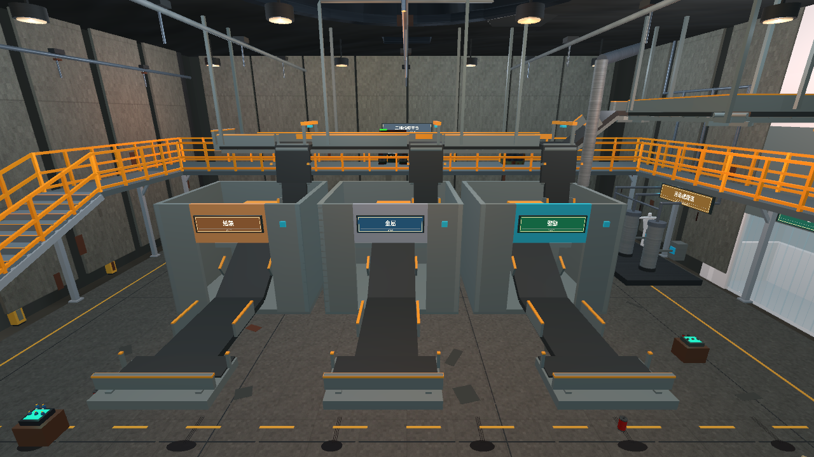
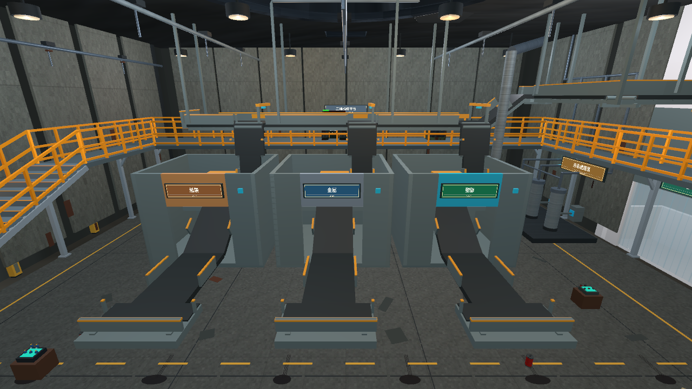

# Level03 V13 — Editor / Play 場景同步

## A. 基準與範圍

- 工作目錄：`C:\Users\h7796\Desktop\Project\Codex Work\Unity\SDG Adventure_R`
- 遠端：`https://github.com/LinSean-ww/SDG-Adventure-Recycle.git`
- 基準：`9e1030c`，執行 `git fetch origin` 後 `origin/main` 與本機 main 相同。
- 開發分支：`codex/level03-v13-editor-scene-sync`；不合併、不 push main。
- Unity：本機 **2023.1.22f1**；不升級 Packages 或 Render Pipeline。
- 開始前已有 `ProjectSettings/ProjectSettings.asset`、`ProjectSettings/Packages/com.unity.testtools.codecoverage/Settings.json` 與未追蹤 `.vscode/`；保留並排除提交。

## B. 根本原因與盤點

`C_Main.unity` 原先只保存舊工廠。`C3FactoryPresentation.Awake` 在 Play 加入 Workshop、ReferenceEnvironment、RecyclingLineGeometry、RecyclingLine、Circulation、WorkstationVisualUpgrade。前三種靜態生成器在 Awake 建模，工作台外觀在 Start 建模；Stop 時 Unity 丟棄這些未保存物件。

| 生成器 | 原本生成內容 | V13 處理 |
| --- | --- | --- |
| `C3ReferenceFactoryEnvironment` | `C3_ReferenceRecyclingFactory_Visuals`、獨立工業標牌、廠房、地板、處理設備、管線、吊燈、老化裝飾 | 明確 `EnsureLayout`、保存 root / lamps / 統計；事件仍在 OnEnable/OnDisable 綁定 |
| `C3RecyclingLineGeometry` | `C3_P2_RecyclingLine`、30 段輸送帶、3 台分類機、標牌、裝飾貨棧 | 保存機器、輸送端點、碰撞面、滾輪、動態材質引用；重建非序列化 MaterialPropertyBlock |
| `C3V3Circulation` | `C3_V3_VerifiedCirculation`、兩側樓梯、平台、護欄、支撐 | 保存建構根物件、護欄 MeshCollider 使用的 Mesh Asset |
| `EcoFactoryWorkshop` | `EASTER_EGG_EcoQuantumWorkshop`、`C3_Distributed_Materials_And_Energy` | 保存兩張工作台、3 個材料點、9 個能源拾取物的初始配置與互動引用；不保存 claimed/collected/powered 狀態 |
| `C3WorkstationVisualUpgrade` | 4 組 `V11_StationArt_*`、控制台碰撞代理、材料點外觀、表面裝飾 | 保存外觀及借用標牌原始位置；重建可移除外觀的 Runtime 材質所有權 |
| `C3SalvageAppearance` | 9 組 `V11_SalvageArt_Visual` | 保存視覺模型與提示引用；Runtime 仍管理提示、啟停與拾取 |

`C3FactoryDecay` 是舊版停用路徑，現行 V12 測試要求它不存在；V13 沒有啟用它。玩家外觀、武器、VFX、UI、背包、任務進度、原料與成品仍屬 Runtime。`C3V12FactoryPreview` 保留原檔，仍可作唯讀畫面比較。

舊模型處理完全沿用 V12 範圍：停用 `C_Factory_Art` 的 Renderer，但保留上層工作台及配電箱子樹；只停用 `RetiredArtCollisionPaths` 清單中的舊裝飾 Collider。Circulation 只停用舊階梯踏板、指定平台／欄杆／支撐的安全葉節點；帶 MonoBehaviour、子物件或 Trigger 的節點不會被退休。`WasteSortingLine` 保留元件並沿用 V12 位置調整。沒有刪除原場景的遊戲邏輯。

原先輸送線的 Machine、Sections、端點、ProcessBed、Press、Pusher 等引用只存在記憶體。因此僅用 GameObject.Find 然後 return，會讓回收系統找不到路徑或設備。V13 保存這些初始配置引用，`C3RecyclingLine.Awake` 明確呼叫 `geometry.EnsureLayout()`，讓初始化不依賴元件 Awake 排序；遊戲 session、批次與獎勵帳本仍每次 Play 重新建立。

## C. 實作與資產

- **已 Bake 的正式 `C_Main.unity`**：直接開啟即可看見並選取新版工廠，無須先 Play 或手動 Bake。保存 2,881 個生成物件，具有完整引用。
- `ArtFull/V13Baked/FactoryLayout.asset`：集中保存 **95 個 Material、16 個 Mesh** sub-assets，連同 `.meta` 提交；既有模型、材質、Prefab 引用繼續使用既有資產。
- `C3BakedFactory.cs`：V13 manifest，列出生成物件與五個 builder，不包含遊戲進度。
- `C3FactoryLayoutAssets.cs`：持久資產容器。
- `C3FactoryLayoutUtility.cs`：只在建構階段區分 Edit 的立即移除／Play 的延後移除；Runtime 清理不破壞持久資產。可移除的工作台及拾取外觀使用一份 session 材質副本，以維持原 V12 移除元件時的清理契約。
- `C3ConveyorSection.cs`：保存 Start/End/Surface/SurfaceRenderer/Width。
- 上表六個 builder：將純建構提取成明確入口，保存必要引用，保留 Runtime 事件、動畫與清理邏輯。
- `EcoWorkshopInteractable.cs`：保存工作台 owner 與 StationKind；claimed 保持非序列化。
- `C3ProximityHint.cs`：保存提示顏色／燈引用；僅 Play 擷取與改寫燈狀態，Start 重建提示資料。
- `C3RecyclingLine.cs`：建立 session 前保證幾何與非序列化快取就緒。
- `C3VisualBuilder.cs`：視覺 primitive 的多餘 Collider 可在明確 Edit 建構期間安全移除。
- `Editor/C3V13FactorySceneTools.cs`：Validate Scene、Preview Bake Changes、Bake Factory、Validate Baked Factory，以及 batch 入口。
- `Editor/C3TextLifecycle/C3V13FactoryBakeTests.cs`、`PlayMode/C3V13BakedFactoryTests.cs`：保存／重新載入、重複 Bake、手動子物件、破損拒絕、Undo/Redo、Play/Stop、Runtime 重新綁定及重新載入測試。

未加 ExecuteAlways、未反射呼叫 Runtime Awake/Start、未複製 Play Hierarchy。Editor 明確建構初始配置，不生成 `C3RecyclingLine` 或 `P2_TRACKED_MATERIALS`。

工具限制在單獨開啟的正式 C_Main，因舊 builder 仍使用名稱尋找原場景物件。已 Bake 時只驗證後 no-op，**不重建、不刪除、不覆蓋使用者編輯**；遺失 manifest／物件時會報錯，請 Undo 或使用 Git 還原。沒有自動清除舊 Bake 的功能。

Undo 還原 Scene 的建立物件、元件、舊 Renderer／Collider／Transform 與 RenderSettings；Asset sub-assets 留下以支援 Redo。Undo 後若決定放棄 Bake，先確認資產未被 Scene 引用，再自行以 Git 檢查未使用資產。資產容器使用唯一檔名，不會覆蓋已有資產。這使用 Unity 的 [AddObjectToAsset](https://docs.unity.com/en-us/engine/6000.7/script-reference/unityeditor/assetdatabase/addobjecttoasset) 機制，並在專案指定的 2023.1.22f1 實測。

## D. 測試結果

本機 Unity 2023.1.22f1 編譯及首次 Bake／保存／重開成功。EditMode **9/9 PASS**（原有 4、新增 5），涵蓋原 V12 圖像預覽、字型生命週期、重複 Bake、破損拒絕、Undo/Redo、合法 Transform／自訂子物件保存、輸送線引用重新載入與 Play/Stop。

Play/Stop 測試比對全部 2,881 個已保存物件的世界位置、旋轉與縮放，並確認正式 Scene 檔案 SHA-256 沒有改變。沒有將遊戲 session 保存到 Scene。

首輪完整 PlayMode batch：V13 169 項，124 通過／42 失敗／3 略過。為區別既有失敗，使用 Git **9e1030c 的原始程式與 Scene**，在相同專案路徑／Unity／使用者設定跑基準，得到 168 項，124 通過／41 失敗／3 略過。V13 只新增標牌清理失敗：Unity 反序列化空 parent 引用後產生 managed fake-null；Runtime 重新綁定時正規化為原始 null 語意。未更改原有 Assert。

有視窗的最終 PlayMode：**169 項，131 通過／35 失敗／3 略過**。新增 V13 測試及標牌清理測試通過；最終 35 項失敗均出現在 V12 batch 基準失敗清單中，沒有新增的失敗測試名稱。兩輪執行模式不同，這不是「整套測試全綠」的宣稱。完整逐項結果與基準對照見 [TestResults.json](Level03_V13/TestResults.json)。

| 重要測試組 | 最終結果 |
| --- | --- |
| Phase2 回收線 | 18/18 |
| Phase2.1 設備與空間 | 7/7 |
| 回收模型／展示 | 6/6、8/8 |
| 安全通行／任務配置 | 7/7、5/5 |
| 第三人稱武器／外觀生命週期 | 6/6、22/22 |
| V12 工人外觀 | 4/4 |
| V13 保存設備重新綁定與重載 | 1/1 |
| V12 工廠修正 | 13/15，2 項原有 F 互動測試失敗 |
| V12 follow-up | 4/18，14 項原有互動／趴行輸入測試失敗 |
| V11 第三人稱互動 | 0/5，5 項均在基準失敗 |

**未完成的驗收**：既有失敗測試的根因修復不屬本次靜態場景同步範圍；不會改玩家輸入邏輯或放寬測試來使結果全綠。實際玩家鍵鼠操作、所有互動與趴行流程仍需使用者在其正常操作環境驗收。應以 Draft PR 交付，驗收後再決定合併。3 項既有略過測試保留原設定。

原始本機證據：`Logs/V13-bake-final.log`、`Logs/V13-edit-final-results.xml`、`Logs/V12-baseline-play-results.xml`、`Logs/V13-play-interactive-results.xml`。原始 log 留在忽略目錄，提交的是去除本機環境紀錄的測試摘要與渲染圖。Unity 產生的 YAML 空欄位尾端空白保留原生格式；`git -c core.whitespace=-blank-at-eol diff --check` 通過。

相同相機位置、FOV、解析度（1280×720）的實際 Unity 渲染：

| Edit Mode | Play Mode |
| --- | --- |
|  |  |

目視確認主廠房、三台機器、輸送帶、樓梯與欄杆一致。啟動光源與距離提示保留 Runtime 行為，圖片不宣稱逐像素相同。

另外已在 Windows Unity Editor 直接執行 UI 驗證：開啟正式 C_Main、切到 Scene（Play 按鈕未啟動）、點選分類機 `MACHINE_SIDE`，Inspector 正常顯示 Transform、Cube Mesh、BoxCollider、持久材質；V13 工具的 **Validate Baked Factory** 顯示 2,881 物件／30 段／3 台／4 站並通過。測試後場景未留下未保存的修改。

## E. GitHub 交付

此分支提交程式、Scene、持久資產、全部必要 `.meta`、測試與本報告。使用者原有設定不提交。PR 待使用者驗收後才合併；main 不變。

## F. Windows Unity 操作與驗收

1. 切換／拉取 `codex/level03-v13-editor-scene-sync`，用 Unity Hub 開啟指定 `_R` 專案及 **2023.1.22f1**。切換前先保存自己的修改，不使用 reset --hard / clean。
2. 開啟 `Assets/_Modules_/02_Levels/Level03/Scenes/C_Main.unity`。此交付已 Bake，**不需要手動 Bake**。
3. 選單 **SDG Adventure → Level03 V13 → Factory Scene Tools**，先按 **Validate Scene**，再按 **Validate Baked Factory**。應顯示 2,881 個初始物件、30 段輸送線、3 台設備、4 個工作站。
4. Hierarchy 的 `M3_Treasure` 下可找到 `C3_ReferenceRecyclingFactory_Visuals`、`C3_P2_RecyclingLine`、`C3_V3_VerifiedCirculation`。Workshop／散落資源／部分標牌是獨立根物件；工作站外觀保留在原互動物件下。
5. 選取固定裝飾，例如 `Industrial wall-longitudinal supply`，在 Inspector 修改 Transform，Ctrl+S；關閉重開 Scene 應保持修改。新增自己的子物件後再次 Bake，也不應被刪除或重置。測試完可 Ctrl+Z 並保存。
6. 建築裝飾可自由移動；輸送線是實際物理與路徑共同配置，編輯應將整段的表面、START/END、連接設備一起調整，並重新 Validate。樓梯／平台的 Mesh、Collider 與玩家通行關係必須一起驗收。移動單獨端點而留下原 Collider 不屬合法連通配置。
7. Play：確認只有一份三大工廠根物件；測試 FPS/TPS、移動、兩側樓梯、二樓、趴行、B/C 與 D 出入口、三個任務零件與控制台、啟動工廠、分類／壓縮／成品收集、材料點、組裝武器、背包、射擊及 VFX。Stop 後工廠仍在；再進 Play，進度應照原遊戲規則重新初始化。
8. **Window → General → Test Runner**，EditMode 搜尋 `C3`，PlayMode 搜尋 `C3`；測試前先保存所有場景。測試使用真實 C_Main，既有輸送線／碰撞／武器測試仍為驗收依據。
9. Git 檢查：`git status --short`、`git log -1 --oneline`、`git diff origin/main --stat`。`.vscode` 及原有 ProjectSettings 修改可繼續留在本機；應提交的是此報告列出的 Level03／測試檔案。
10. 返回 V12：先提交自己的 V13 編輯或以 `git stash push -u` 妥善保存，再切回仍停在 `9e1030c` 的 main，重新開啟 Unity。若 main 日後已變更，可另建本機復原分支指向 `9e1030c`。不要只替換 Scene 而混用 V13 程式／資產；不要強制覆蓋未提交工作。

### 可重現的 batch 指令

在專案根目錄 PowerShell 執行（確保沒有另一個 Unity 開著同一專案）：

```powershell
$unity = 'C:\Program Files\Unity\Hub\Editor\2023.1.22f1\Editor\Unity.exe'
& $unity -batchmode -projectPath "$PWD" -runTests -testPlatform EditMode -testFilter C3 -testResults "$PWD\Logs\V13-edit-results.xml" -logFile "$PWD\Logs\V13-edit.log"
& $unity -batchmode -projectPath "$PWD" -runTests -testPlatform PlayMode -testFilter C3 -testResults "$PWD\Logs\V13-play-results.xml" -logFile "$PWD\Logs\V13-play.log"
```

每一個 Unity 程序完成後才執行下一個；需要畫面驗證的測試不要加 `-nographics`。若使用 Start-Process，加入 `-Wait`。首次未 Bake 場景可使用 `-executeMethod C3V13FactorySceneTools.BakeBatch -quit`；已 Bake 時為驗證與保存，不會覆寫配置。
